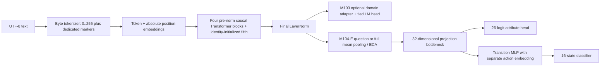

# Independent architecture audit — 2026-10-26

## Scope and verdict

Inspected branch `m104-e-and-m105-a`, initial HEAD `c353b1ff4ee5c9d3772635718912be53eb714424`, initially clean tree. Read project instructions, docs, tiny config, M103–M105 sources/tests, tracked dataset specifications/manifests, and available M103/M104 report artifacts. Latest local completed report is `runs/m104_e_output/m104_e_milestone_report.json` with its Markdown companion: PARTIAL, 6/10 gates. Existing kernel `sparklinghydraulics0/amg-m104-e-grounding-transfer` was queried and returned COMPLETE. This verifies completion status, not the scientific claims or an immutable kernel version/source match. No M104/M105 tracked data manifest or complete report-level checkpoint/data/runtime provenance was found.

The current implementation is **a salvageable experimental Transformer substrate, but not yet a scientifically qualified foundation for claims of persistent conceptual learning, learning-to-learn or self-improvement**. There is no evidence here that the Transformer family or current size is fundamentally incapable. There is direct evidence that some reported experiments did not deliver the intended inputs or preserve the intended labels. Repair those contracts before testing architecture size. This audit is source-based plus mock regressions; new neural effects require remote measurement.

Source references below identify functions and approximate lines in the reviewed source; repairs can move line numbers. Paths are relative to `src/adaptive_mini_gpt/` unless specified. Historical results are preserved.

## Actual architecture and execution paths

`configs/tiny.yaml` is the two-layer production CLI baseline. M103 independently constructs a four-layer, width-128, four-head, FFN-512, vocabulary-1024, context-256 student, then inserts a fifth block (`natural_language_learning_m103/text_student_m103.py:45–105`). These are distinct configurations. The unused vocabulary range above the 264 byte/special IDs adds unused output alternatives. It does not itself prove learning failure.

M103 `forward_lm` embeds tokens, manually traverses blocks, normalizes, optionally applies a rank-2 domain adapter, and decodes with weights tied to `wte`. `prune_orphaned_lm_head=True` ties the base head too. Default false retains a second unused base head. M104-E `extract_sequence_hidden_states` manually traverses the same blocks, then pools and classifies. It does **not** call M103 domain adapters, LM output, layer routers, production skip connections or the persistent knowledge store. Registered capacity therefore differs from active and trainable capacity. Historical zero-orphan certificates do not apply to every new forward path.

The standard attention path uses causal SDPA, pre-norm residual blocks and right padding. Right padding cannot affect earlier real token states under causal attention; M104 pooling masks padding. Default absolute positions are coherent within the fixed window. There is no evidence from source alone of useful learned language representations. No meaningful language-pretrained checkpoint is loaded by default: M104 repeatedly constructs fresh `TextStudentM103` instances. Foundation and language controls in E3 are trained within that experiment rather than continued from the historical student.

## Confirmed defects and validity failures

| ID / classification | Source evidence | Consequence / action |
| --- | --- | --- |
| A1 CONFIRMED BUG | `concept_learner_m104_e._encode_batch_tensors` (reviewed lines 143–145), `grounded_extractor_m104_e` evaluation/calibration, and byte-only `tokenizer_m103.encode` | Literal marker strings become bytes, never `QUESTION_ID`/`ANSWER_ID`; pooling falls back to the latter half of the sequence. Repaired with shared structured prompt encoding while preserving raw-byte API. |
| A2 CONFIRMED BUG | Same encoder slices `[:220]`; inherited `STANDARD_RULES` is **335 UTF-8 bytes** | For standard prompts, all 220 bytes are rule text; neither question nor entity description reaches the neural model. The lexical baseline sees the untruncated question. This is unequal evidence, not proof that lexical reasoning beats learned extraction on equal inputs. Complete prompts now fail explicitly above context budget. Merely fixing marker IDs cannot fit 335 rule bytes into 256 positions. |
| A3 CONFIRMED BUG / SCIENTIFIC VALIDITY ISSUE | Encoder `.get(action, 0)` and `.get(expected_state, 0)`; transfer world specs use new names | All four actions in **each** of the five transfer worlds are outside the base action vocabulary. Most target states are outside the base state vocabulary and become Dormant/class zero. Near-91% transfer accuracy is invalid evidence of unfamiliar causal learning. Unknown names now raise. Shared, explicit vocabulary/head design remains required. |
| A4 CONFIRMED BUG | `causal_world_m104_b.generate_datasets_m104b`, paraphrase split (around line 167) | Copies original `question_text` while storing the alternate in an unused field. Identical novel/paraphrase scores are not two demonstrations. Repaired to feed the alternate text; still correlated cases. |
| A5 CONFIRMED BUG | `text_student_m103.evaluate_exact_match` around line 249 | Accepts any generated string containing target text. Strict normalized full equality repaired. Historical consumers must be requalified separately. |
| A6 CONFIRMED BUG | `model/transformer.configure_optimizers` around line 235 | Decays 2D embeddings unless a selective mask happens to exist. Repaired by embedding parameter identity, protecting tied aliases as well as positional embeddings. Direct research AdamW constructors still bypass this helper. |
| A7 CONFIRMED BUG | `concept_learner_m104_e.run_phase_e0_audit` around line 207 | Hard-coded best strategy ECA even though report shows question 25.5, full 26.2, ECA 22.9 F1. Repaired argmax label. Strategy comparison is untrained and cannot prove leakage suppression. |
| A8 CONFIRMED BUG | `grounded_extractor_m104_e.evaluate_neural_extractor` | Forced top-1 prediction when threshold selects nothing; calibration does not use this fallback. Removed fallback so calibration and evaluation agree and empty sets are valid. |
| A9 CONFIRMED BUG | `self_modification_m105_a.apply_and_evaluate` around lines 190–262 | Exception before retention evaluation references uninitialized `retention_passed`, causing a second error instead of a rejection result. Repaired initialization. Unsupported structural enums formerly committed as successful no-ops; now reject. Non-finite metrics now reject. |
| A10 CONFIRMED BUG | `model/transformer.py:325` consumes `mod_loss`/`mod_routed_fraction`; `adaptive/mod.py:72–89` returns `mod_aux_loss`/`mod_active_token_fraction` | Auxiliary router objective and telemetry silently disappear. Not repaired in this focused patch; requires a remote gradient regression before enabling MoD. |
| A11 CONFIRMED BUG | `model/attention.py` RoPE branch pairs `rotate_half` with `repeat_interleave(2)` frequencies | Half-split rotation needs matching duplicated halves of frequencies; current pairing does not implement the intended rotation. Dormant in current absolute-position student. Keep RoPE experiments unqualified pending isolated rotary/reference tests. |

## Architectural limitations and gradient analysis

**DESIGN LIMITATION:** `semantic_bottleneck_m104_e.SemanticBottleneckM104_E.forward:79–112` receives `global_repr` but never uses it. It is not an explicit context-conditioned transition. Causal rule text can still influence question hidden states and ECA, so this does not prove total context independence. It does mean that entity attributes and world rules must be disentangled through the same entity vector; attribute supervision and varying rule context can compete. Test paired rule swaps and context ablation before adding another module. Do not wire context in blindly and call the resulting change successful.

**DESIGN LIMITATION:** Selective plasticity trains embeddings, the last block and final norm; four lower blocks remain random and frozen. The inserted last block starts with zero residual outputs. At the first update its inner attention/MLP weights may have zero gradients by construction; output projections can learn, then unblock inner gradients. Zero gradients at t0 are not automatically orphaned parameters. Freezing random layers may make generalization difficult; this remains an **UNVERIFIED HYPOTHESIS**, especially because the original experiment omitted the descriptions.

**SCIENTIFIC VALIDITY ISSUE:** “Question-only” pools causal hidden states already influenced by preceding rules. ECA attends to all prompt positions without an entity-only key mask. Neither operation guarantees suppression of rule contamination or resolves multiple entity references. Entity resolution, negation, distractor entities, contradictory descriptions and independently held-out paraphrase families are largely untested.

**DESIGN LIMITATION:** The student is a supervised state classifier in this path. The bottleneck is a low-rank projection lifted back to width 128 with auxiliary labels; state prediction need not use the predicted tags themselves. Attribute F1 and state accuracy must be reported separately and causally connected by ablation, not assumed to constitute concepts. Action IDs are observable structured inputs, so “text-only” really means tokens plus supplied action category. World tags are training supervision and evaluation labels; their absence at inference does not validate the rest of the pipeline.

Optimizer groups are built from currently trainable parameters. M105 changes masks after optimizer construction without adding newly trainable parameters. Rehearsal in M103 computes old-domain losses through frozen old-domain adapters and a frozen backbone, so it cannot protect those paths through gradient updates; exact isolation can still protect them. Actual replay benefit must be measured in the shared-plastic path. The new diagnostic logs nonzero gradients and optimizer coverage instead of inferring connectivity from registration.

## Persistence and self-modification

**CONFIRMED BUG / SCIENTIFIC VALIDITY ISSUE:** M105 snapshot captures tensors, optimizer/scheduler state dicts, Torch/Python RNG and a replay copy (`self_modification_m105_a.create_snapshot:111–137`). It does not capture topology registrations, optimizer parameter references/groups, arbitrary trainability masks, train/eval flags, NumPy RNG, `replay_ratio`, learned controller values/counts/counter, external memory, disk checkpoints, or metadata. A newly registered module makes strict restore fail; matching optimizer group lengths do not establish parameter identity. Replay restore extends with snapshot object references, so later mutation can mutate a reused snapshot. No complete recovery claim is justified. This patch fixes rejection behavior, not that transaction design.

M103 save/load persists model weights, tier, growth flag and counter; it omits replay, optimizer, scheduler and RNG and is not an atomic full learning checkpoint. Loading reconstructs the default shape and head-alias configuration, not arbitrary evolved topology. Production `training/checkpoint.py` is more complete and atomic, but does not automatically cover M104 wrappers or M105 state. A fixed-model logit roundtrip is narrower than resumed-learning equivalence.

**SCIENTIFIC VALIDITY ISSUE:** M105 “backbone update” changes a mode without optimization; “adapter allocation” scales all existing bottleneck weights (including norms/biases); “rehearsal” changes an attribute only if it exists. It performs no rehearsal. The policy is a small empirical operator-value bandit with developer priors and fixed operator hyperparameters, not a demonstrated neural meta-learner. A bandit could be useful, but only if its decisions affect real bounded learning and improve independent future encounters.

The policy arms run sequentially on the same changing student and shared evaluation set; random uses different hyperparameter choices; no learning-cost accounting or isolated future tasks; tied 100% acceptance with zero gain is counted as learned success (`concept_learner_m104_e:825`). Gate 10 tests proposal generation rather than learned advantage. Regimes C/D in E2 assign baseline accuracies without executing modular adaptation or transactional rollback (`:495–501`). These are placeholders, not measurements.

## Growth, routing, memory and technical debt

Identity depth insertion correctly zeros dense residual output projections for the current dense float32 path. Generic insertion omits dtype copying, config layer-count reconciliation and MoE output zeroing. Expanding a learned top-k expert router with zero-logit rows can change the selected old experts and their normalized weights even when new expert outputs are zero (`adaptive/experts.add_experts`). Therefore zero new outputs alone do not prove function preservation for an already active MoE. Test trained, negative-logit routers at t0; task-conditioned isolation is a different case.

Dynamic layer skipping pools the entire sequence, then uses `exec_mask.any()` for the whole batch (`dynamic_transformer_substrate.py:43,131`; M103 `forward_lm` similarly). If enabled for causal language modeling, future tokens and unrelated batch companions can change execution of an earlier prefix. The discrete decision has no direct task gradient estimator here. It is disabled in M104-E. Do not equate the correct token-local MoD eval rule with this sequence router.

M96 memory stores explicit facts and routes with supplied episode type/abstention flags (`persistent_memory/integrated_student.py:88–153`); fact lookup is a real storage capability, not language acquisition. It is not integrated into the M104-E forward. Many milestone packages coexist, with repeated manual embedding/block loops and incompatible checkpoints. Preserve historical implementations, but select one versioned live student interface rather than adding another parallel specialist stack. The audit samples the historical mechanisms relevant to current claims; it is not an exhaustive certification of every legacy benchmark or code path.

## Evidence ranking and next decision

Real engineering assets: causal dense Transformer, differentiated neural losses, trainable modular components, bounded experimental controls, a production checkpoint manager, and historical remote runs. Reported tiny arithmetic fitting shows an optimization loop can memorize; it does not show unseen arithmetic generalization. Oracle-attribute prediction is an upper bound for a different input problem. Factual retrieval is external memory behavior. Current text grounding, retention from established competence, positive future learning efficiency and learned self-modification remain unqualified.

Root-cause priority: missing input and collapsed labels (confirmed); misleading evaluation (confirmed); random frozen representations, sparse/ambiguous supervision, byte sequence length, loss balance and optimization budget (hypotheses); insufficient model size (unsupported). The smallest redesign is a complete structured input contract, explicit label vocabulary, one continuing checkpoint lineage and independently separated development/sealed evaluation. Keep the present dense student and compare simple pooling plus trainability controls before modifying representation dimensions or adding capacity. See REFACTOR_PLAN and RESEARCH_INTEGRITY.

## Additional source checks while the remote feasibility job ran

The same literal-marker/truncation pattern exists in `concept_learner_m104_b.py:191–192`, `concept_learner_m104_c.py:194–195`, `concept_learner_m104_d.py:126–127` and `grounded_extractor_m104_d.py:147–148`. Thus the apparent M104-D to M104-E extraction improvement does not isolate a semantic architecture gain. Historical implementations are retained; they are not approved alternative runners for new claims.

`concept_learner_m103_g1.py:420–428` passes simulator-derived tag indices to the standalone predictor in both training and evaluation. Its reported 72.7%/81.0% is an oracle-attribute neural generalization result, not end-to-end language acquisition. In the same file, `calc_mean_and_ci` (around line 515) uses `1.96 * standard_error` with five seeds. A normal approximation is not a justified small-sample confidence certificate; use a declared paired world/seed model (with its assumptions) or appropriately designed resampling. The data consist of correlated procedural cases, not 640 independent world draws.

In `causal_world_m104_b._generate_world` (around lines 65–82), extra novel objects receive material tags by list position, but their description contains affiliation, exotic prefix and form without the assigned material name. Some target attributes may not be observable from text. This is a **SCIENTIFIC VALIDITY ISSUE** for exact extraction: validate whether every target attribute is entailed by available descriptions before asserting that optimization should recover all labels. The lexical micro-F1 being high does not establish complete information for every class or entity.

`active_practice_m104_c.ActivePracticeEnvironmentM104_C.query_simulator:94` bounds calls, but accepts any supplied item without enforcing membership in the candidate pool or split. That is an **implementation boundary limitation**, not evidence that a particular run leaked: caller-level isolation must be audited, and final holdouts must remain inaccessible by construction.

M102 checkpointing (`dynamic_transformer_evolution/persistent_student_m102.py:450–510`) reconstructs block count and saves exemplars/memory but not optimizer/scheduler/RNG state. Its constructor also performs foundation work. A roundtrip claim from that separate subsystem cannot establish complete M104/M105 resumed learning. Consolidation (`:331–393`) updates shared weights with rehearsal and checks per-family retention, a useful mechanism to preserve; its state-dict-only rejection remains narrower than transactional recovery.

**DESIGN LIMITATION — shared-output retention:** M103 ties its language output to `wte`; M104-E makes `wte` trainable while bypassing the LM output. Consequently semantic classification updates can change later autoregressive output logits even if many backbone tensors are frozen. Selective row gradient masks alone also do not generally protect tied output probabilities or existing optimizer momentum. No language retention certificate follows from frozen lower blocks. Preserve exact old-model/output behavior only through an explicit compatible protection contract, tested on actual prior behavior remotely.

## Remote regression discoveries and minimal compatibility restoration

Version 1 full suite completed with 718 passes / 25 failures / 1 skip. Further **CONFIRMED BUGS**: `MiniGPT` no longer exposed `generate`, `get_num_params`, `get_active_params_per_token` or `inspect_architecture`; they exist in Git revision `9d1dad4` and were removed in subsequent model rewrites. This breaks production CLI inspect/generation and retention/evaluation utilities. Restore the prior methods instead of inventing replacements; guard absent absolute positional embeddings in the restored non-embedding counter, and label active capacity as an estimate rather than a measured speed result.

**CONFIRMED BUG:** `data/dataset.py:276,289` returns targets at positions `i+1 .. i+T`; `training/trainer.py:184,274` passes them unchanged to MiniGPT. The reviewed forward then shifts again, training a two-token-ahead objective and rejecting `-1` answer masks. Restore the already-aligned target contract, treating both -1 and -100 as ignored labels. This is distinct from M103's own explicit shifted LM loss, which remains correct and unchanged.

**CONFIRMED BUG:** TopKRouter returns `entropy` and `utilization`, while MiniGPT consumed different names, silently dropping routing diagnostics. Restore the actual key contract and backwards-compatible outward aliases. MoD's recorded A10 and RoPE's A11 are repaired in the follow-up with focused remote tests; their original defect evidence above remains part of the audit record. The two M104 test expectations are updated to require actual alternate question text and deliberate context-overflow rejection. They no longer assert that a paraphrase payload remains unused or that a rule-only smoke run is meaningful.

## Input indistinguishability proof

A local-safe byte-fixture check constructed a wooden-tool question and a metal-vessel question with the same standard rule and Apply_Fire action. The reviewed encoder `encode(f"<bos><rule>{STANDARD_RULES}<sep><question>{question}<sep><answer>")[:220]` produced exactly identical token lists. Since `STANDARD_RULES` is 335 bytes, **all standard-rule examples share the same truncated neural text**. At deterministic evaluation, the attribute representation cannot distinguish their entities; the transition head has only the supplied action ID left to distinguish standard cases. This is a direct information loss proof, not a capacity hypothesis. Increasing model size cannot recover an omitted observation. It explains why a lexical baseline given the actual question is not a fair neural architecture comparator. Correcting inputs is necessary but not sufficient: the new complete-input feasibility result still shows a real generalization gap.
