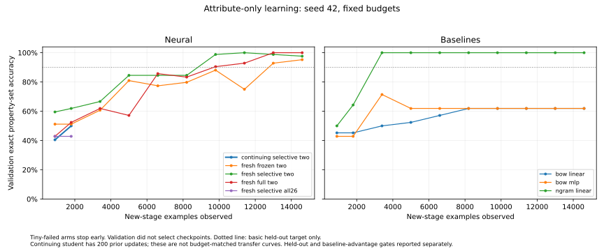

# Stage A: isolate attribute acquisition

Status: IMPLEMENTED and remotely executed; scientific Stage A FAIL, full-regression ERROR. No concept is promoted. This continues foundation qualification on `m104-e-and-m105-a`, not a new milestone. The combined concept-binding study remains FAIL and its artifacts/reports are immutable. `reports/` is absent; completed scientific reports reside in `docs/` and preserved `runs/` outputs.

## Hypothesis and minimal intervention

The combined experiment did not isolate language, binding, transitions or optimization. The canonical owner always computed state CE plus 26-label BCE. That is a valid joint objective for fully annotated tasks, but prevents an attribute-only update without irrelevant state supervision. `LearningState.step` now accepts omitted state targets and explicit observed attribute columns. Its default joint-loss mathematical contract stays unchanged. Selecting two observed columns avoids assigning negatives to 24 properties outside this experiment; an all26-negative control tests that supervision choice. Neither a historical BCE bug nor the root cause of the old collapse is assumed.

Reuse the same dense Transformer, byte tokenizer, question pooling, concept projection and existing attribute head. No new component, capacity, representation, threshold search or architecture growth. The action placeholder cannot influence attribute logits; the action/transition/state weights must remain unchanged. This parameter check does not prove behavioral retention of prior skills through changed shared representations.

## Protocol fixed before remote results

`data/specs/attribute_learning_v1.json` is binding. One object has two independently annotated traits, each positive, negated or absent. All nine combinations occur in training. Single-object property negation is required; multi-object binding and transitions are excluded. Training and validation use two grammars with disjoint names. The two heldout splits separately test new names in known grammar and new names in two unseen description templates. Property words and negation operators remain familiar. This is controlled grammatical generalization, not novel-world or causal qualification.

The generator emits labels from annotations, never by parsing text at student inference. The neural learner receives complete rules and descriptions only; no status/family IDs, labels or structured features enter inference. Export every delivered token sequence, exact text reconstruction, data hash, class/family counts, logits and actual predictions. All label combinations and all three status families must be covered. Exact-word-count matched negation examples demonstrate a bag-of-words ambiguity; word 1–3-gram linear remains a stronger control and may solve this task. A lexical win/tie is an honest limitation, not grounds to weaken its baseline.

Primary lineage: continue the existing selective student from `amg-concept-binding-foundation/1`, SHA256 `4a4f79fcd07b5bbe58bad5da04ce1a934696438c8603e9e6296e398a4b5ed5d8`, after its 200 joint tiny updates. Retain weights and optimizer moments. Declare a new owned sampler at the stage boundary; the old artifact lacks a persisted sampler, so this is not retrospective exact resumption. Verify parent hash and update count, fail closed if missing. Old checkpoint immutable. The new stage stores protocol, supervision, sampler and counters with the continuing owner. Unqualified final checkpoints are candidates, not promoted knowledge.

Fresh frozen/selective/full two-column controls share seed42 initialization and sampling. Fresh selective all26 is the loss diagnostic. These are controls, not new persistent specialists. The continuing student's extra 200 historical updates mean it is not a budget-matched transfer comparison. No learning-to-learn inference is allowed. Majority, BOW linear, BOW MLP32 and word 1–3-gram linear receive the same descriptions. Vocabulary fits training only. Neural and lexical arms have matched new-stage observation/update ceilings, but GPU compute/parameters differ and are reported separately. Tiny-failed neural arms stop early and cannot be ranked on unrun heldout scores.

Budget: seed42, LR.002, decay0, clipping1, batch<=16; 200 tiny updates over one example per annotation combination, then800 main. Stop each neural arm below95% tiny exact. Validation every100 updates; no hyperparameter/checkpoint selection. Heldout evaluated once at fixed endpoint. Basic acquisition requires train exact>=95%, both heldout exact>=90% and positive/negated/absent accuracy>=90% in each. Reusable qualification additionally requires >=10 percentage points over the strongest simple control in BOTH heldout splits. No statistical independence is assumed between grammar cases; one seed cannot qualify broad concepts. No seed shopping or post-test threshold changes.

If primary fails any gate, STOP at Stage A. Inspect development curves, per-status failures, predictions and the matched two-vs26 loss control; do not add architecture to force PASS. Entity binding, one-step transitions, composition, feedback, retention and future-learning efficiency remain NOT RUN. A–G are successive learning stages of the same owner, not seven solvers. Even feasibility success requires independent replication before promotion.

## Execution and rollback

LOCAL: lint/type/syntax/mock-only. Inspect/run only `tests/test_attribute_learning_fixtures.py` locally: three tiny string/token fixtures. Actual loss/gradient tests and canonical updates in `tests/test_attribute_learning_remote.py` are REMOTE-REQUIRED. All training, inference and full tests require Kaggle/Colab CUDA; the entry point aborts elsewhere.

REMOTE: Kaggle GPU, template `kaggle/launch_attribute_learning.py`, private job ID `sparklinghydraulics0/amg-attribute-learning`, attach `kernel_sources=["sparklinghydraulics0/amg-concept-binding-foundation"]`. Commit/push before rendering `__PINNED_SHA__`. Hash-check the attached parent. Limits: contracts240s, study600s, full suite1200s. A script completion is not scientific PASS. Preserve failures/timeouts and all historical artifacts. No local CPU fallback.

Remote commands executed by pinned launcher:

```bash
python -m pytest -q tests/test_foundation_structure.py tests/test_foundation_mock_contracts.py tests/test_attribute_learning_fixtures.py tests/test_attribute_learning_remote.py --junitxml=/kaggle/working/attribute-learning/contracts.xml
python scripts/run_attribute_learning.py --output-dir /kaggle/working/attribute-learning --parent <attached-selective_plasticity.pt>
AMG_RUN_GPU_TESTS=1 python -m pytest -q --junitxml=/kaggle/working/attribute-learning/full-suite.xml
```

Rollback: retain immutable parent and unpromoted output separately. Source changes are a scoped Git revert. No preexisting checkpoint or historical report is overwritten. Structural operations remain disabled in this study; long-term architectural eligibility is unchanged.


## Remote result: STOP at Stage A

Kaggle `sparklinghydraulics0/amg-attribute-learning`, version1, source **216c3d5059b6e6e5bbb199f7c4ffbab4234488ba**, Tesla T4, Python3.13.15 / PyTorch2.11.0+cu128 / CUDA12.8. Overall kernel **ERROR**: install,19 focused contracts and study exit0; full suite exit1. **773 passed,1 failed,0 skipped in621.23s**; contracts19 passed in19.12s. A failed whole job is not a qualified completed run. Individual study observations below are preserved diagnostic evidence, not scientific PASS. No neural run is attributed to the later reporting-only revision.

| Arm | Tiny exact | Train exact | New names exact | New names + syntax exact | New updates / examples | GPU-process wall s |
| --- | --- | --- | --- | --- | --- | --- |
| Continuing selective, two labels |88.89%|NOT RUN|NOT RUN|NOT RUN|200 /1800|3.60|
| Fresh frozen, two labels |100%|92.26%|92.86%|44.05%|1000 /14600|12.78|
| Fresh selective, two labels |100%|100%|94.05%|42.86%|1000 /14600|16.74|
| Fresh full, two labels |100%|100%|100%|42.86%|1000 /14600|22.32|
| Fresh selective, all26 labels |44.44%|NOT RUN|NOT RUN|NOT RUN|200 /1800|3.01|
| BOW linear |77.78%|61.90%|61.90%|61.90%|1000 /14600|1.37|
| BOW MLP32 |88.89%|80.95%|61.90%|71.43%|1000 /14600|1.67|
| Word1–3-gram linear |100%|100%|100%|100%|1000 /14600|1.39|
| Majority |44.44%|42.86%|42.86%|42.86%|0|not timed|

Primary continuing learner fails the unchanged95% tiny gate. It stops after200 new updates (400 lifetime recorded updates); no main/heldout evaluation is invented. Fresh controls diagnose this same stage, not alternate promoted students. All thousand-update arms see14600 examples; two stopped arms see1800. Primary extra historical200 updates/moments are explicitly outside the matched fresh comparison. No transfer speedup or retention estimate is calculated.

All429 token sequences independently decoded locally from the completed artifacts match exact rules/descriptions. Maximum152/256 tokens. Split sizes168train,84validation,84names,84syntax and9tiny (training subset). All9 annotation families present; each property positive in56/168train and28/84heldout. Data SHA256 **985f8fa3cefb9fdaec05f252a6d3fe56950d95c00f1f4a0ffccc9a144e6de18e**. Deduplication leaves unequal family counts; this is reported, not treated as balanced binary classes. Majority42.86% is the actual baseline, not chance50%.

Every fresh neural control has identical initial tensor hash `b4b586814e27dc7dffbaf3471e098c54730e38651942fed62a6e8a00ed32242c`. Primary starts from historical selective tensor hash `cb5c90b050daffbdf32712bba1a9acff5646121a11cb37943312553270434f4d`. Stored capacity stays **1,255,636**; registered trainable frozen77,162, selective406,762, full1,255,636. These counts include inactive registered machinery, not effective compute. All transition/action/state parameter hashes remain unchanged. Shared features changed, so this is not behavioral old-skill retention. Each long neural arm observes1,672,297 nonpadding training tokens; stopped arms190,800. Times are synchronized GPU-process wall times, not device-only event time. No external simulator queries are made during learning; observations are finite static generated supervision.

### What is isolated

**Confirmed improvement in this development protocol:** fresh selective two-label supervision fits all9 tiny cases100%, versus44.44% with the same initial weights, minibatch stream,200-step budget and attribute-only all26 objective. The latter predicts00 on every tiny case. Relevant BCE gradients are diluted13-fold by averaging over26 rather than2 columns, and24 negative-output terms also change shared gradients. This controlled contrast supports observed-label supervision; it does not distinguish dilution from interference, establish universal optimal loss weighting, or isolate the cause of the old joint-task failure. The default fully annotated joint objective remains available unchanged.

**Confirmed unresolved acquisition failure:** the continuing student's error is `Object A: not flammable; conductive.` -> `[0,0]`, truth `[0,1]`, logits `[-9.04852,-0.54369]`. The history did not reliably satisfy even the tiny criterion under the new budget. This is not qualified negative transfer: weights, optimizer history and preceding objective are jointly different from fresh initialization.

**Confirmed failure of generalization:** fresh selective/full reach100% train but predict00 on **all84** new-name/new-template descriptions. Positive-property recall is0%; negated/absent accuracy100% therefore provides no evidence of negation understanding. Example full prediction: `For object W, the description is: flammable; conductive.` -> `[0,0]`, truth `[1,1]`, logits `[-5.03586,-12.29097]`. Frozen predicts00 on83/84. Strong n-grams solve both heldout distributions100%, showing that text and supervision suffice for a much simpler learner. These neural results do not qualify independent property acquisition.

**Validity limitation:** new-name U/V in known syntax and new-name W/X in new syntax are different groups. Full's100% on U/V and42.86% on W/X plus syntax implicates the combined shift, not syntax alone. Next development diagnosis must cross the same names with both grammars before attributing a cause or changing pooling/representations. New independent final cases must then be sealed. Do not tune these viewed84-case tests. Unknown function-word frames, random byte representations, pooling and optimization remain hypotheses; no evidence for insufficient parameter capacity was established.

**Historical reinterpretation check:** archived prior-study selective/full tiny errors remain75%/50% exact even on the two relevant tags, with zero false positives in the other24 classes. The old failed gate was not merely an all26 scoring artifact. Historical results are unchanged.

### Regression failure and explicit unresolved backend risk

The single failed test is `tests/test_kaggle_backend.py::test_gpu_qualification`. Production CLI reaches global steps2 then4, increases tokens128->256, and reports finite FP16 losses. `scripts/qualify_gpu.py:116` rejects because an Adam state's applied-step counter is not4. Raw trace does not print actual optimizer counters or scaler values, and its temporary qualification checkpoints were not exported. Therefore **optimizer recovery is NOT certified by this run**, and no exact skipped-update count is invented.

Code inspection identifies separate risks: `cli.cmd_train` constructs `MiniGPT` before `Trainer._set_seed`, so its configured seed does not determine initial weights. `Trainer.train` increments global steps and advances the scheduler after `GradScaler.step` even if overflow skips the actual update. The qualifier equates attempted global steps with every Adam counter. AMP-skipped updates are a plausible explanation, not proven from the retained failure alone. These paths predate Stage A and are distinct from the FP32 canonical owner;19 owner/gradient/topology contracts passed. Do not lower the Adam counter assertion or claim clean regression. A bounded backend reproducer must export both checkpoint states, scales and actual applied-step counters before a targeted repair. No expensive science rerun, seed selection, threshold relaxation or unrelated refactor is justified here.

### Artifacts, reproduction and current scope

Raw immutable artifacts: `runs/kaggle-attribute-learning/output-v1/attribute-learning/` plus parent kernel log. Tracked provenance, checkpoint/file hashes, test counts and summaries: `data/manifests/attribute_learning_v1.json`. CSV: `data/manifests/attribute_learning_v1_curves.csv`.



Submission/retrieval commands (source pushed before launch):

```bash
# Render __PINNED_SHA__ in kaggle/launch_attribute_learning.py to the full216c3d5 SHA.
# Metadata and exact rendered launcher are retained in runs/kaggle-attribute-learning/job/.
kaggle kernels push -p runs/kaggle-attribute-learning/job
kaggle kernels status sparklinghydraulics0/amg-attribute-learning
kaggle kernels output sparklinghydraulics0/amg-attribute-learning -p runs/kaggle-attribute-learning/output-v1
```

LOCAL checked: inspected `python -m pytest -q tests/test_attribute_learning_fixtures.py` **3passed**; targeted compileall, Ruff lint/format, Pyright with `/tmp/amg-repair-pyright.json` package/script/test extraPaths, and `git diff --check`. Completed JSON/token/hash analysis and static plotting only. REMOTE:19contracts, real neural study and full suite on Kaggle T4. No local forward/backward, checkpoint loading, optimizer updates or full pytest.

Reproduce completed-metric plot without loading weights (optional matplotlib in temporary environment):

```bash
UV_CACHE_DIR=/tmp/amg-plot-cache UV_PYTHON_DOWNLOADS=never MPLCONFIGDIR=/tmp/amg-mpl uv run --offline --no-project --python .venv/bin/python --with matplotlib scripts/plot_attribute_learning.py --results runs/kaggle-attribute-learning/output-v1/attribute-learning/results.json
```

The final bookkeeping-only driver change emits null comparisons for arms without heldout measurements. Raw216c3d5 artifacts contain numerical zero-based gap placeholders for stopped arms; these are not measurements, are ignored in this report, and remain immutable. All actual logits, training, gates and verdict are unchanged. No full-suite pass is attributed to the reporting revision.

**Verdict: Stage A FAIL; backend regression ERROR; overall PARTIAL engineering progress.** Stop before B–G. No checkpoint is promoted. The existing architecture remains a testable research substrate; reusable language concepts, established-knowledge retention, positive future-learning efficiency and autonomous neural self-improvement remain unqualified. The smallest next step is a controlled development-only name/template factorial and loss-gradient diagnosis, alongside the bounded FP16 backend reproducer. No new architecture component is warranted.


Exact files changed in this continuation:

- `README.md`
- `docs/04-experiments.md`
- `docs/05-roadmap.md`
- `docs/06-data-pipeline.md`
- `docs/CANONICAL_LEARNING.md`
- `docs/FOUNDATION_DEFECT_REGISTER.md`
- `docs/ATTRIBUTE_LEARNING.md`
- `data/specs/attribute_learning_v1.json`
- `data/manifests/attribute_learning_v1.json`
- `data/manifests/attribute_learning_v1_curves.csv`
- `docs/figures/attribute_learning_v1_curves.svg`
- `src/adaptive_mini_gpt/data/attribute_learning.py`
- `src/adaptive_mini_gpt/training/learning_state.py`
- `scripts/run_attribute_learning.py`
- `scripts/plot_attribute_learning.py`
- `kaggle/launch_attribute_learning.py`
- `tests/test_attribute_learning_fixtures.py`
- `tests/test_attribute_learning_remote.py`
