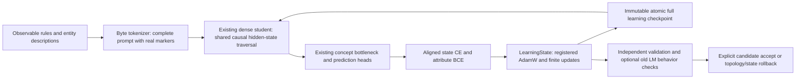

# Canonical learning pathway

This is the active stabilization/qualification path from audited baseline `d7fbedd`, not a new milestone. Historical milestone APIs are retained for reproduction; the twelve M103/M104 scientific CLIs listed in `data/manifests/legacy_foundation_entrypoints.json` are unsupported for new claims. Other legacy paths are uncertified, not implicitly approved.



Input: `ByteTextTokenizerM103.encode_prompt` preserves UTF-8 fields, inserts dedicated special-token IDs and rejects overflow; `pad_batch` rejects clipping. `scripts/run_concept_binding.py:encode` uses the actual model's context length and checks exact reconstruction of rule/question fields. Targets and diagnostic oracle features never enter the language student's input. Supplied action IDs are observable categories derived from explicit action text and included in simple baseline controls. The 256-position model remains this study's configuration, not a permanent architectural ceiling. Context/tokenizer/topology changes require an explicit migration and new qualification.

Student: existing `TextStudentM103` plus `IntegratedStudentM104_E`, without new semantic modules or additional capacity. Both language output and concept extraction traverse `DynamicEvolvableBackbone.hidden_states`, reducing competing manual Transformer loops. Default dense execution is unchanged; supervised concept prediction uses question pooling over causal hidden states and existing heads. Global context can influence those states through attention; the unused explicit global representation is still a limitation. Registered ECA/domain adapters/routers are not assumed active in this path.

Loss: the state head uses aligned classification CE; the attribute head uses aligned BCE-with-logits. These are not next-token losses. Production `MiniGPT` already-shifted target loss and M103 `forward_lm` external shift remain distinct documented contracts. The canonical state owner checks optimizer membership, finite loss/gradients and clips gradients before the actual update. Every declared label in the synthetic world is observable by construction; the simulator supplies research targets only. Arbitrary legacy datasets are not drop-in inputs.

Optimizer: canonical two-group AdamW registers all live parameters, including temporarily frozen ones, preserving dormant optimizer moments across freeze/unfreeze. Frozen gradients are cleared. Embeddings and one-dimensional tensors receive no weight decay. `migrate_adamw` retains unchanged parameter identities and states, drops removed parameters, and initializes newly added parameters lazily. Replaced tensors require explicit old/new prefix-expansion maps; device/dtype changes, shrink maps and arbitrary connection permutations reject. Width/vocabulary/context/attention resizing is not automatically enabled by this helper.

Persistence: `training/learning_state.py` owns model, optimizer, scheduler, external state and metadata. Joint deep copies preserve parameter aliases, optimizer ownership, topology, module registration, flags, gradients, Python/NumPy/Torch CPU/all-CUDA RNG states and all declared replay/memory/controller data. Batch-selection RNGs and sampler position must also live under the owner; the driver records them explicitly. Trusted same-code full-object checkpoints reconstruct dynamic topology without re-running training constructors. A new process must produce an identical next update, optimizer/scheduler state and RNG draws. Checkpoint files publish atomically, are fsynced and cannot overwrite prior files. Candidate checkpoints cannot publish. Checkpoint publication is not automatic production promotion.

Scope: all mutable learner state must live under the owner or its declared `external` graph. Arbitrary external filesystem effects, third-party services, undeclared global generators, custom hooks, cross-version class changes and different CUDA device counts are unsupported. Callbacks must operate only on owned state; validation must not train or mutate external resources. After rollback, callers must reacquire child modules/parameters from the root owner; old external child references are invalid. Python object copying is bounded by experiment memory budgets and is not an efficient universal topology serializer. Existing legacy M105 snapshots are still partial and are not the canonical transaction layer.

Adaptation: whole-block routing applies a token-local probability/threshold to the block residual. It computes the block before gating and makes **no compute-saving claim**. It does not use future-token pooling or batch-wide `any()`. Dense identity insertion copies dtype/device, zeros dense and adaptive residual outputs and updates actual depth metadata. Learned expert growth preserves existing top-k normalization cohorts, adding an independent zero-output residual cohort. This changes post-growth routing semantics: active slots may increase with cohort count; stored/active capacity and cost must be reported, not equated with a flat fixed-k router. Cohort boundaries persist in state and configuration. Flat pre-cohort checkpoints load as one cohort. Automatic task-ID modulo expansion is unsupported because it can remap old tasks.

Retention: updating tied `wte` through classification can change language probabilities. A remote behavioral test demonstrates that drift and rejects/restores the candidate exactly. This is a tested rejection guard, not a guarantee that ordinary classification training retains a previously learned language skill. Real prior-task competence, delayed retention and interference measurements remain required.

Structural validation scope: exact eval t0 invariants and subsequent gradients are tested; training-time dropout/noise trajectories are not claimed function-preserving. Destructive pruning is only an isolated candidate that must validate or roll back, never an automatic production operation. Depth/experts/prefix-state migration are the supported tested mechanisms; arbitrary width, context, vocabulary, representations and connection rewrites stay disabled until their own invariants are defined. Their future eligibility remains part of LONG_TERM_VISION.md.

Neural qualification commands run **only inside Kaggle/Colab CUDA**:

```bash
python -m pytest -q tests/test_foundation_structure.py tests/test_foundation_mock_contracts.py
python scripts/run_concept_binding.py --output-dir /kaggle/working/concept-binding
AMG_RUN_GPU_TESTS=1 python -m pytest -q --junitxml=/kaggle/working/full-suite.xml
```

The pinned launchers are `kaggle/launch_foundation_stabilization.py` and `kaggle/launch_concept_binding.py`; render `__PINNED_SHA__` only after committing/pushing. Actual results, negative cases, revision and remaining gaps are in FOUNDATION_STABILIZATION.md. A software pass does not qualify concept acquisition or self-improvement.


Stage A now isolates positive, negated and absent attributes using the existing persistent student and explicit attribute-only supervision. Protocol, fixed gates, lineage and actual run status: [ATTRIBUTE_LEARNING](ATTRIBUTE_LEARNING.md). No entity-binding, transition, transfer or architecture-growth milestone is advanced.


Stage A diagnostic/backend continuation: [protocol and evidence](STAGE_A_DIAGNOSTIC.md). FP16 progress now distinguishes attempted/skipped/applied updates, seeds before initialization, and restores exact tested continuation. Backend source db9ef68 passes778 remote full-suite tests. The historical773pass/1fail result stays preserved; development-only language/history diagnostics do not qualify concepts or advance Stage B.

Final Stage A diagnostic core17d8c6f: **781 remote tests pass**. Continuing student100% on familiar frames with familiar/new names, but21.43% on new frames despite known byte IDs; n-gram100% in all four cells. Original88.9% tiny fitting is rescued by resetting backbone Adam state in a controlled training-only ablation. This does not repair wording generalization or qualify transfer. No checkpoint promotion or Stage B; full evidence is in STAGE_A_DIAGNOSTIC.md.


Stage A.2: **Engineering PASS / Learning FAIL, STOP**. Final experimental source `d25a9bf` passes792remote tests on Kaggle T4. The pinned100/100/21.43/21.43% result reproduces exactly. Matched grammar/order/prefix exposure raises primary new-name/new-frame development accuracy to60% /52% (streams42/43), versus100% for n-gram controls, while acquisition and prior-frame retention fail. Sealed cases remain ungenerated; no capacity change, checkpoint promotion or milestone advance. Full protocol, isolated Adam-history controls, exact revisions and negative artifacts: [STAGE_A2](STAGE_A2.md).

Final provenance-only source `cbf2f82` is separately verified: **793remote tests pass**,13focused contracts pass; six metadata-only checkpoint copies retain exact learning state and next-update behavior. Scientific results stay pinned to d25a9bf; Learning FAIL and the sealed-test stop remain unchanged.


Stage A.3 is a bounded tiny-acquisition study using the same continuing student, balanced frames and optional parameter-free paired consistency. Protocol, admission gates and actual status: [STAGE_A3](STAGE_A3.md). No new milestone, neural module, capacity increase or autonomous reset; sealed qualification remains gated on stable acquisition and prior-frame retention. LOCAL static/mock checks only; all neural/full-suite work remotely on Kaggle CUDA.

Stage A.3 completed: **PARTIAL**, engineering808remote passes/16focused contracts at `4e1cc9f`. Balanced BCE reaches100%on all156tiny training targets at1000/1100/1200updates, but old-frame observations fall to66.67%/71.43%. Paired consistency ends100%but dips to92.31%and fails stability. Default-backward numerical divergence is reproduced and an explicit checkpoint-declared deterministic policy repairs the matched no-op invariant and fresh-process continuation. No sealed cases, reset policy, promotion, capacity growth or milestone advance. [Exact evidence and commands](STAGE_A3.md).

The A.3 owner optionally accepts explicit disjoint same-target pairs and a finite positive consistency weight. Default BCE remains bit-identical to the original contract; paired consistency adds no trainable tensor and is experimentally **unqualified**. The driver owns pair streams/cursor and persists the objective schema. New checkpoint-declared numerical policy is opt-in: strict algorithms, pre-process CUBLAS workspace :4096:8 and cudnn benchmarkFalse; updates fail on mismatch rather than silently configure global state. Legacy undeclared behavior is preserved. State restoration alone cannot guarantee an identical next update on nondeterministic kernels. Same-code/runtime/device/policy continuation is now tested on the actual trained student; cross-version/global-flag mutation remains unsupported.
