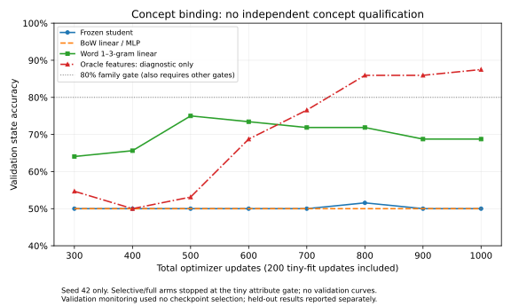

# Foundation stabilization and learning qualification

## Preflight and scoped plan

Continue branch `m104-e-and-m105-a`, clean baseline `d7fbedd52cc052b0d296b02302f97ffcb228a9ab`. Existing architecture/audit/repair/vision/integrity documentation and historical reports remain applicable; the active scope is foundation stabilization, not M105 advancement. The latest completed audit run is 754 passes/one opt-in skip. M104-E/M105-A historical PARTIAL 6/10 and original gates are not changed. The canonical path and new gates below are separate research protocols.

LOCAL: lint/type/syntax/mock-only. REMOTE: Kaggle or Colab GPU training/full tests. Never run neural forward/backward/checkpoint qualification locally.

1. P0: centralize the existing student's hidden-state traversal, explicit aligned loss/update and optimizer ownership; preserve complete UTF-8 prompts and actual model context budget. Introduce a single versioned learning-state owner for model/optimizer/scheduler, flags, RNG, replay/memory/controller and metadata. Checkpoint publication is atomic; rejected candidates cannot publish. Legacy unsafe scientific CLI entry points reject by default with an explicit historical-reproduction override.
2. P1: token-local gating for whole-block residuals (no compute-saving claim); fix dtype/topology metadata for depth insertion. Expert growth hypothesis: keep each existing top-k normalization cohort unchanged and add a new independently normalized zero-output residual cohort. This uses the same experts and expanded router parameters, plus integer cohort metadata; it adds no semantic module. Standard top-k is unchanged until growth. Expected benefit: exact eval logits even with negative trained old logits, while new output projections can receive gradients. Control: old flat expansion, negative-logit reproducer. Persist cohort boundaries; do not silently reinterpret old/new checkpoints.
3. P1: explicit AdamW migration preserves unchanged parameter identities/states; resized replacements require an explicit prefix map. Arbitrary resizing/pruning semantics remain unsupported. Joint snapshots preserve topology and optimizer aliases. Test rejected insertion/deletion/resize, trainability, scheduler, all RNGs, external state and next update, including fresh-process reload. Tied LM outputs receive behavioral retention checks; classification drift must be detected and rollback restored, not described as prevented by a frozen tensor.
4. Only after foundation contracts pass remotely, P2: one seed 42 bounded dense-student feasibility with balanced order-sensitive minimal pairs, independent properties, negation, references and one/two actions. Hold out property combinations and descriptions; use strict per-family results, majority/bag-of-words/linear and diagnostic oracle controls. No oracle enters the language student. Fixed validation intervals, actual predictions/steps/examples/compute and immutable artifacts. Gates: tiny training fit >=95%, independent family accuracy >=80%, and >=10 percentage-point advantage over strongest unstructured simple baseline; no baseline saturation. Changed-law feedback/retention is gated on established competence. Stop on failure without adding capacity.
5. P3/P4 remain conditional: no learning-to-learn or controller research without independent concept generalization and retention. No autonomous structural promotion.

Budget: one T4 foundation job (focused tests <=240s, full suite <=1200s), then one T4 single-seed concept diagnostic <=600s only after the foundation passes. A rerun is justified only by a specific observed implementation failure; no seed/threshold selection after held-out results. Rollback of implementation: revert scoped commits; previous checkpoints/results never overwritten. Canonical snapshots are trusted same-code experiment files, not a general untrusted model import format.

## Verified first foundation run

Source `155f4a751fda540ab4e375d4ea40b6d9fd0bda9c`, Kaggle `sparklinghydraulics0/amg-foundation-stabilization`, version 1, COMPLETE, Tesla T4 / PyTorch 2.11.0+cu128 / CUDA 12.8. Historical negative-logit expert growth and dynamic-routing reproducers each failed at `d7fbedd`; repaired contracts **29 passed in 14.59s**. Full suite with `AMG_RUN_GPU_TESTS=1`: **763 passed, no skips** in 622.38s. The opt-in GPU qualification now ran and passed. One existing docstring SyntaxWarning remains. Artifacts: `runs/kaggle-foundation-stabilization/output-v1/foundation-stabilization/`.

This verifies exact learned-expert t0 preservation and new gradients, token-prefix/batch independence, adaptive float64 depth identity, optimizer prefix moments/freeze transitions, topology/optimizer/scheduler/memory/controller rollback, tied-output drift rejection and matching next updates in a fresh process. It does not certify arbitrary topology operations or old M105 transactions. Follow-up adds explicit RNG/flags/publication tests and immutable checkpoint publication before concept qualification; those require the next remote run. Local checks: two new mock tests plus two inspected optimizer fixtures passed; syntax, scoped lint and new state-owner type checking passed. A static typo in the initial ownership edit was corrected in `155f4a7` before submission; no result is attributed to the untested earlier revision.

## Prespecified concept feasibility

See `data/specs/concept_binding_v1.json`. Research simulator `data/concept_binding.py` constructs paired observations with identical word multisets and opposite state labels by swapping which entity owns which properties. It is never used as a deployed reasoning engine. Language inference uses only complete text and the supplied last-action category; structured property/law/parity inputs go exclusively to the separately labelled diagnostic oracle MLP.

Train/test hold out joint two-entity property relationships, names and description syntax. Individual property bundles, trait words and two law schemas are familiar; this is not novel-rule/vocabulary transfer. One/two action toggles are commutative, so success would not prove noncommutative action-order reasoning. Two traits are independently crossed; the remaining 24 attribute logits are outside the world's trait inventory and have no positive labels. All metrics must be interpreted as a two-trait study, not broad 26-class extraction.

A fixed seed 42, 200 tiny updates and 800 main updates are declared before any held-out score. Compare frozen/selective/full existing students, majority, BoW linear/MLP, word1–3-gram linear and structured diagnostic MLP. All trainable arms use the same observations/steps/minibatch stream; actual compute/capacity is reported separately. Validation is monitored at 100-step intervals without checkpoint selection; test descriptions and compositions are evaluated once at the fixed endpoint. Tiny fit failure stops the neural arm. No learning-to-learn or learned-controller claim is possible from this single feasibility study. Negative results stop further learning complexity.

## Additional confirmed alias defect and bounded rerun

The initial joint-graph restore preserved parameter ownership but grafted copied model/optimizer dictionaries into live roots without rebinding external controller references to those roots. A pure-Python mock reproducer failed at `5a7b409`; the correction uses a shared deepcopy memo that maps saved roots to live roots. Candidate root reassignment is explicitly rejected and original root handles are restored on rejection/error. Neural restart tests now include external root aliases and all RNG streams/flags; immutable checkpoint tests verify no overwrites or candidate publication. The bounded foundation rerun includes the historical alias reproducer, all invariants and the full suite. This is a specific justified correction, not a seed or benchmark search. The already-submitted concept study uses data-only controller state and its training path is unaffected; its results retain their own exact source SHA.

## Concept result: FAIL — stop at acquisition

Kaggle `sparklinghydraulics0/amg-concept-binding-foundation`, version 1, COMPLETE; source `5a7b409fc0e8312708328fbddaca54cf0dd6e332`; Tesla T4 / Python 3.13.15 / Torch 2.11.0+cu128 / CUDA 12.8. Foundation checks 10 passed in 18.25s; full regression 765 passed with no skips in 606.17s. The kernel completed successfully but **the scientific result is FAIL_STOP_NO_TRANSFER_OR_GROWTH**.

No threshold, seed, training budget, label, model component or acceptance gate was changed after this result. The root-alias correction was independently reproduced and committed before viewing these scores; it does not change the study's data-only training/controller path. The raw run and all negative outputs remain immutable.

| Arm | Tiny state / attribute exact | Main train state | Unseen-description state / attribute exact | Unseen-composition state / attribute exact | Updates / examples | GPU-process wall seconds |
| --- | --- | --- | --- | --- | --- | --- |
| Frozen backbone |100% /100%|50%|50% /33.59%|50% /16.02%|1000 /14400|14.58|
| Selective backbone |100% /75%|NOT RUN|NOT RUN|NOT RUN|200 /1600|3.10|
| Full backbone |100% /50%|NOT RUN|NOT RUN|NOT RUN|200 /1600|4.08|
| BoW linear |50% /25%|50%|50% /38.67%|50% /24.61%|1000 /14400|1.33|
| BoW MLP |50% /50%|50%|50% /42.97%|50% /38.28%|1000 /14400|1.54|
| Word 1–3-gram linear |50% /87.5%|65.63%|50.78% /42.19%|49.61% /19.14%|1000 /14400|1.35|
| Structured oracle MLP: diagnostic only |87.5% /100%|80.86%|80.86% /100%|68.75% /100%|1000 /14400|1.57|
| Majority |50% /not applicable|50%|50%|50%|0|not timed|

Selective/full arms stop at the declared 95% tiny attribute gate, so they have **no held-out measurements** and are not fairly ranked against 1000-update arms. These are different realized budgets, explicitly reported; no speedup ratio is calculated. All 1000-update arms receive the same 14400 sampled observations and minibatch stream. Canonical neural training clips gradients at 1; simple controls use their documented plain AdamW updates. Actual compute is not equal and is not represented as equal.

Frozen student's worst-family accuracy is 50% across absence, negation, references and chains. Its final predictions are **class 0 for every one of 256 train, 256 description and256 composition cases**: zero counterfactual pair flips and zero completely correct pairs on each 128-pair slice. Tiny fitting therefore did not scale to acquisition of the larger training task. This is an acquisition failure, not merely a held-out wording failure.

The oracle is not a successful causal-reasoning certificate: even with privileged property/law/action-parity inputs it achieves only 80.86% train and 68.75% composition accuracy. It also reuses structured target-feature combinations across splits. It diagnoses a representation/optimization gap, but does not isolate language extraction as the only cause or establish perfect transition learning. No oracle inputs reach the text student.

### Input, capacity and artifacts

All 840 delivered prompts were independently decoded from exported token IDs without model execution and matched exact rule/question text. Maximum 238/256 tokens, no clipping. Split sizes: tiny 8, train 256, validation 64, descriptions 256, compositions 256. Canonical data hash `c86584a57e3b80f78be302409ebcf3b50d7e6cf0071416d1c4889d8599945f9c`. Tracked provenance/checkpoint hashes: `data/manifests/concept_binding_v1.json`.

Every neural arm starts with the **same pre-existing state hash** as the preceding audit (`b4b586814e27dc7dffbaf3471e098c54730e38651942fed62a6e8a00ed32242c`). Stored parameter count remains 1,255,636; registered trainable counts frozen 77,162, selective 406,762, full 1,255,636. Registered capacity includes unused ECA/domain machinery; it is not a measurement of effective active computation. No student capacity was increased. Frozen arm processed 2,713,872 nonpadding training tokens; selective/full each 310,800 before stopping.

Artifacts: `runs/kaggle-concept-binding/output-v1/concept-binding/` contains source/runtime provenance, manifest, every case, complete tokens, every evaluated prediction, curves, logs/JUnit and model/optimizer/global-RNG checkpoint per neural arm. The original study driver kept its minibatch sampler outside the owner; these archived checkpoints are therefore not complete autonomous data-stream resumes. These are independent scientific controls, not deployed specialists or an ensemble. Each arm carries its own same student/optimizer through tiny→main without resets. No failed arm/checkpoint is promoted. The study starts fresh for controlled comparison; it does not claim continuation or retained knowledge from historical checkpoints. Output IDs 0/1 mean light-off/on under this protocol; automatic cross-world head/label-ontology migration is not qualified.



Raw curve table: `data/manifests/concept_binding_v1_curves.csv`. Validation point monitoring did not select a checkpoint. All 800 main updates were used. The late oracle validation improvement does not override its held-out failure, and no censored failure is converted into time-to-target. Single-seed correlated procedural cases support no multi-world confidence interval.

### What the failure does and does not establish

**Confirmed:** complete observations, live gradients/optimizer updates and reproducible persistence do not by themselves yield compositional learning. Under this budget the frozen student collapses to a constant state predictor; the more plastic arms have not passed joint tiny attribute acquisition. Stronger simple n-grams do not saturate the held-out task either, so this benchmark avoids the preceding lexical ceiling problem.

**Unverified hypotheses:** broad question pooling may lose entity binding; joint state/attribute supervision can interfere; unused negative output classes and class/loss balance may slow attribute learning; simultaneous introduction of negation, binding, law conditioning and chains may be a poor curriculum. Even the structured control has unresolved optimization/generalization. These are not evidence of a model-size ceiling, and this experiment does not isolate any one mechanism.

**Smallest proposed next research step:** use new development-only fixtures to separate attribute-only positive/negative extraction, two-entity binding, single-step transitions with known attributes, then chains and law changes. Establish tiny and held-out competence at each step with the same dense student and strong controls before combining objectives. Freeze a new untouched test distribution before comparisons. Do not tune these already-viewed test cases or add a semantic module/corpus to force a pass.

**Decision:** stop learning experiments here. Corrective-feedback retention, unfamiliar future-task efficiency, learning-to-learn and learned modification are **NOT RUN / NOT QUALIFIED**. Infrastructure has improved; the next learning breakthrough has not been demonstrated. No milestone advancement.

## Sampler continuity follow-up (no new learning experiment)

The negative study exposed an engineering ownership omission: its local `random.Random` minibatch sampler was not in the checkpoint graph. Future driver checkpoints now own that same sampler under `external`, record phase/update/example/token position and the output/action/tag label schema. Sample calls and seeds are unchanged; the original learning result and incomplete sampler checkpoints remain immutable and are not retroactively requalified.

A focused remote check resumes both the **next sampled batch and optimizer update** in a fresh process, checks the sampler stream plus all global RNG streams, live controller-root aliases, gradients, flags, metadata, scheduler and moments. This follow-up changes persistence ownership and tests only; no neural architecture, loss, training budget, threshold or seed is changed, and no concept training is rerun. The final-core full suite at 092441b is recorded separately from this final focused check.

## Final-core regression and support boundary

The alias/root-handle correction at `092441b952ea2d7c7a46d9b301201e1dee13de55` completed Kaggle foundation kernel version 2: **33 contracts passed in 14.15s; 767 full-suite tests passed, no skips, in 626.03s**. All three historical bug reproducers independently failed as expected (routing, negative-logit growth and root aliases). The one full-suite warning is an existing invalid docstring escape. Evidence/hashes: `data/manifests/foundation_stabilization_v2.json`; artifacts `runs/kaggle-foundation-stabilization/output-v2/foundation-stabilization/`.

The final sampler-owner driver/test change at `7b4b794f691f7c400a61bb6ef2bacc0d722951f4` has the same neural learning core; its separate CONTRACTS_ONLY run does not claim to rerun the full suite or concept study. Dataset identity and label schema must accompany future continuation. Arbitrary representation/width/vocabulary/context migrations, custom hooks, undeclared external side effects, cross-version Python class migration, production MoD training, automatic task-ID expansion and trained controller advantage remain unsupported or unqualified. No permanent architectural ceiling is introduced; these operations require their own future finite experiments.

## Reproducible commands and revision map

LOCAL: lint/type/syntax/mock-only. REMOTE: Kaggle or Colab GPU training/full tests. All actual neural forward/backward, checkpoint loading, behavioral comparisons and process-resume checks in this phase ran remotely.

Local executed checks:

```bash
.venv/bin/python -m compileall -q src scripts tests kaggle
.venv/bin/python -m pytest -q tests/test_foundation_mock_contracts.py
.venv/bin/python -m pytest -q tests/test_architecture_audit_contracts.py -k optimizer
.venv/bin/ruff check src/adaptive_mini_gpt/training/learning_state.py src/adaptive_mini_gpt/training/legacy_entrypoints.py src/adaptive_mini_gpt/training/optimizer_contract.py src/adaptive_mini_gpt/adaptive/router.py src/adaptive_mini_gpt/adaptive/experts.py src/adaptive_mini_gpt/adaptive/growth.py src/adaptive_mini_gpt/dynamic_transformer_evolution/dynamic_transformer_substrate.py tests/test_foundation_structure.py tests/test_foundation_mock_contracts.py scripts/verify_foundation_restart.py scripts/run_concept_binding.py src/adaptive_mini_gpt/data/concept_binding.py kaggle/launch_foundation_stabilization.py kaggle/launch_concept_binding.py
```

Scoped checks passed; five mock fixtures and two inspected optimizer fixtures pass. The root-alias mock first failed before repair. Type checking the new state/legacy/data/runner modules passed with the existing environment's explicit import paths (default Pyright path discovery cannot resolve installed Torch/NumPy):

```bash
python - <<'PYCODE'
import json
from pathlib import Path
root=Path.cwd()
Path('/tmp/amg-repair-pyright.json').write_text(json.dumps(dict(
    extraPaths=[str(root/'src'),str(root/'scripts'),str(root/'.venv/lib/python3.12/site-packages')],
    pythonVersion='3.12',typeCheckingMode='standard')))
PYCODE
.venv/bin/pyright --project /tmp/amg-repair-pyright.json src/adaptive_mini_gpt/training/learning_state.py src/adaptive_mini_gpt/training/legacy_entrypoints.py src/adaptive_mini_gpt/data/concept_binding.py scripts/run_concept_binding.py scripts/verify_foundation_restart.py
```

The plotting cache was initially populated in the temporary environment with network access; omit `--offline` for that initial install. Local analysis independently decoded all completed prompt artifacts and verified canonical data hashes; no model weights were loaded. Plotting uses only completed JSON, with optional Matplotlib in an isolated temporary environment and no project dependency change:

```bash
UV_CACHE_DIR=/tmp/amg-plot-cache UV_PYTHON_DOWNLOADS=never MPLCONFIGDIR=/tmp/amg-mpl uv run --offline --no-project --python .venv/bin/python --with matplotlib scripts/plot_concept_binding.py
```

Remote test commands, inside pinned Kaggle CUDA runtime:

```bash
python -m pytest -q tests/test_foundation_structure.py tests/test_foundation_mock_contracts.py tests/test_architecture_audit_contracts.py tests/test_audit_neural_regressions.py --junitxml=/kaggle/working/foundation-stabilization/contracts.xml
AMG_RUN_GPU_TESTS=1 python -m pytest -q --junitxml=/kaggle/working/foundation-stabilization/full-suite.xml
python scripts/run_concept_binding.py --output-dir /kaggle/working/concept-binding
```

The restart fixture invokes `scripts/verify_foundation_restart.py` in a **fresh remote Python process**, not an in-memory reload. Historical reproducer files are copied outside checkout, the old SHA is checked out, and each original failure runs independently before corrected tests. Exit 1 is expected only for those historical reproducers; all actual failed/timed-out phases remain failures.

Prepare a pinned private job only after committing and pushing:

```bash
python - <<'PYCODE'
from pathlib import Path
import json
sha='092441b952ea2d7c7a46d9b301201e1dee13de55'
job=Path('runs/kaggle-foundation-stabilization/job');job.mkdir(parents=True,exist_ok=True)
(job/'launch.py').write_text(Path('kaggle/launch_foundation_stabilization.py').read_text().replace('__PINNED_SHA__',sha))
(job/'kernel-metadata.json').write_text(json.dumps(dict(
    id='sparklinghydraulics0/amg-foundation-stabilization',title='amg-foundation-stabilization',
    code_file='launch.py',language='python',kernel_type='script',is_private=True,
    enable_gpu=True,enable_tpu=False,enable_internet=True,dataset_sources=[],competition_sources=[],kernel_sources=[],model_sources=[]),indent=2))
PYCODE
kaggle kernels push -p runs/kaggle-foundation-stabilization/job
kaggle kernels status sparklinghydraulics0/amg-foundation-stabilization
kaggle kernels output sparklinghydraulics0/amg-foundation-stabilization -p runs/kaggle-foundation-stabilization/output-v2
```

For the original negative concept study, use source `5a7b409fc0e8312708328fbddaca54cf0dd6e332`, template `kaggle/launch_concept_binding.py`, job directory `runs/kaggle-concept-binding/job`, kernel ID `sparklinghydraulics0/amg-concept-binding-foundation` (title without owner), and output `runs/kaggle-concept-binding/output-v1`. The exact source must be checked out to reproduce the original sampler-checkpoint limitation; do not pretend a rerun of a later commit is the historical result.

For the final sampled-batch check, source `7b4b794f691f7c400a61bb6ef2bacc0d722951f4`, same foundation template, render `CONTRACTS_ONLY = False` to `CONTRACTS_ONLY = True` in the ignored job copy, preserving that run-scope parameter. This runs only contracts and historical reproducers; source/range and absence of a full-suite phase are recorded separately.

Commits: `045371e` foundational implementation; `155f4a7` static ownership correction and first tested source; `5a7b409` prespecified concept study/immutable checkpoints; `092441b` reproduced root-alias correction; `7b4b794` sampler/schema ownership and exact sampled-update check. No historical experiment report is edited and no milestone number is advanced. Source rollback is an explicit Git revert of these scoped changes; no old checkpoint has been overwritten.

## Exact changed files

- `README.md`
- `data/manifests/concept_binding_v1.json`
- `data/manifests/concept_binding_v1_curves.csv`
- `data/manifests/foundation_stabilization_v1.json`
- `data/manifests/foundation_stabilization_v2.json`
- `data/manifests/foundation_stabilization_v3.json`
- `data/manifests/legacy_foundation_entrypoints.json`
- `data/specs/concept_binding_v1.json`
- `docs/02-architecture.md`
- `docs/04-experiments.md`
- `docs/05-roadmap.md`
- `docs/06-data-pipeline.md`
- `docs/ARCHITECTURE_AUDIT.md`
- `docs/CANONICAL_LEARNING.md`
- `docs/FOUNDATION_DEFECT_REGISTER.md`
- `docs/FOUNDATION_STABILIZATION.md`
- `docs/RESEARCH_INTEGRITY.md`
- `docs/SCIENTIFIC_REVIEW_REPORT.md`
- `docs/figures/concept_binding_v1_curves.svg`
- `kaggle/launch_concept_binding.py`
- `kaggle/launch_foundation_stabilization.py`
- `scripts/plot_concept_binding.py`
- `scripts/run_concept_binding.py`
- `scripts/run_m103_a_benchmark.py`
- `scripts/run_m103_b_benchmark.py`
- `scripts/run_m103_c_benchmark.py`
- `scripts/run_m103_d_benchmark.py`
- `scripts/run_m103_e_benchmark.py`
- `scripts/run_m103_f_benchmark.py`
- `scripts/run_m103_g1_benchmark.py`
- `scripts/run_m103_g_benchmark.py`
- `scripts/run_m104_b_benchmark.py`
- `scripts/run_m104_c_benchmark.py`
- `scripts/run_m104_d_benchmark.py`
- `scripts/run_m104_e_benchmark.py`
- `scripts/verify_foundation_restart.py`
- `src/adaptive_mini_gpt/adaptive/experts.py`
- `src/adaptive_mini_gpt/adaptive/growth.py`
- `src/adaptive_mini_gpt/adaptive/router.py`
- `src/adaptive_mini_gpt/data/concept_binding.py`
- `src/adaptive_mini_gpt/dynamic_transformer_evolution/dynamic_transformer_substrate.py`
- `src/adaptive_mini_gpt/model/config.py`
- `src/adaptive_mini_gpt/model/transformer.py`
- `src/adaptive_mini_gpt/natural_language_learning_m103/semantic_bottleneck_m104_e.py`
- `src/adaptive_mini_gpt/natural_language_learning_m103/text_student_m103.py`
- `src/adaptive_mini_gpt/training/learning_state.py`
- `src/adaptive_mini_gpt/training/legacy_entrypoints.py`
- `src/adaptive_mini_gpt/training/optimizer_contract.py`
- `tests/test_foundation_mock_contracts.py`
- `tests/test_foundation_structure.py`

## Final focused result and overall verdict

Kaggle foundation kernel version 3, source `7b4b794f691f7c400a61bb6ef2bacc0d722951f4`, **COMPLETE, CONTRACTS_ONLY**: all 33 contracts pass in 17.36s, including exact next sampled batch and fresh-process model/optimizer/scheduler/RNG continuation. Historical reproducers each fail independently as expected. No full-suite or concept-study phase is claimed for that run. Manifest: `data/manifests/foundation_stabilization_v3.json`; artifacts: `runs/kaggle-foundation-stabilization/output-v3/foundation-stabilization/`.

The final scalar capacity-ledger fix `2c9cfe7` counts per-cohort active experts (and one expert in task routing) rather than the old global top-k. A pure fake-parameter reproducer failed with 80 instead of 100 before repair; all five mock fixtures pass after repair. This changes introspection arithmetic only, not logits, gradients, optimization, RNG or any experimental result. The full neural-core 767-pass and sampled-resume 33-pass evidence above remains scoped to its exact revisions; the full suite is not falsely attributed to the final reporting/ledger HEAD.

| Priority | Verdict | What remains |
| --- | --- | --- |
| P0 canonical input/update/persistence | VERIFIED within documented owner/schema/runtime scope | Arbitrary legacy paths and cross-version/undeclared side effects are not certified; original negative-study sampler omission stays recorded. |
| P1 supported reversible adaptation | VERIFIED invariants and restart for tested mechanisms | Untested resize/representation/context/vocabulary/task-ID operations disabled or unqualified; competent old-task retention is not established by arbitrary probe equality. |
| P2 reusable concept acquisition | **FAIL** | Frozen student fails larger-task acquisition; plastic arms fail joint tiny attribute qualification. No higher-capacity or extra-module response is justified. |
| P3 learning-to-learn | NOT RUN | Requires concept generalization, established old competence and multiple independent future worlds. |
| P4 learned self-modification | NOT RUN | Requires retention, future-learning benefit and independently qualified policy advantage. |

**Overall PARTIAL:** a substantially more trustworthy experimental learning foundation, with a scientifically useful negative concept result. One persistent student is supported by the canonical owner and continuation tests; no ensemble of specialist solvers or autonomous promotion was introduced. No reusable concept, positive forward-learning efficiency or neural self-improvement is claimed. Stop here and retain all failure evidence.
