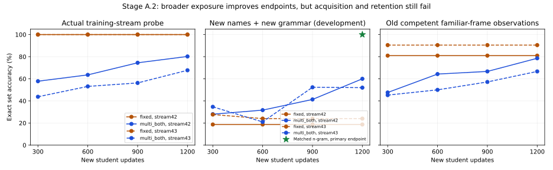

# Stage A.2: frame-invariant concept learning

Preflight: clean `m104-e-and-m105-a` at9431421. Existing docs, tiny.yaml, architecture/integrity contracts and STAGE_A_DIAGNOSTIC.md remain binding. Latest full core evidence is781remote passes at17d8c6f, not an intelligence qualification or a pass falsely attributed to this new revision. No new milestone. Historical artifacts/checkpoints remain immutable; no `reports/` directory exists.

LOCAL: lint/type/syntax/mock-only. REMOTE: all real neural inference/training, checkpoint tests, retention and full regression on Kaggle CUDA. No CPU fallback.

## Prespecified finite plan

A. Load the exact1400-update candidate from COMPLETE `amg-stage-a-diagnostic/2` (file SHA2563e93d7238bfdb706ddfd49ee9903fed8b1e6f577529537f1e21cae12e905b262). Regenerate pinned data/hash c2f7f254a540367f037f60f1832e1dc7c6a4fe9d5c3267f5f1d9fdaf7ff08ffb and compare every historical primary prediction/logit against tracked CSV. Decode complete prompts/masks/positions. Keep its checkpoint file immutable and apply no model update during inspection. Examine position-ID offsets0/4/16/32 without changing tokens, masked pooling, per-label gradients, existing concept/head outputs, and fixed ridge readouts of frozen pooled/concept features (diagnostic coefficients only, never attached to student). No tuning or training against old shifted cases; familiar old training labels fit the diagnostic readout only. Attention/span-pooling inspection remains diagnostic, never a privileged deployed extractor.

B. Same inherited1400-update student, selective plasticity, no parameter/capacity/tokenizer/context change. Five curriculum controls: original two training frames; six balanced training families; multi+property-order variation; multi+irrelevant-prefix variation; multi+both. Use paired streams42/43, each1200updates/batch16/lr.002/decay0/clip1, two observed labels. Every arm sees identical sampled semantic status/name factors; frame/order/prefix factors are drawn for all arms even when unused. Statuses independently uniform positive/negated/absent per property. Train names are off-diagonal two-letter combinations of J/K/L/M; development names are diagonal pairs, all constituent bytes observed during training. New development families are disjoint from training families AND the already-viewed shifted cases. Old shifted cases are used only for fixed reproduction/inspection, never curriculum optimization, checkpoint selection or new-parameter tuning. Old competent familiar-frame cases are retention observations, not replay.

Budgets: five arms x two paired learning streams x1200updates =12000new updates,19200examples/arm; inherited weights identical, seeds describe new learning/sampling streams, not independent backbone initializations. Fixed endpoint; curves every300updates. Raw observed-text n-gram controls get corresponding training streams and budgets. Actual costs and parameters recorded separately, not falsely compute matched. Primary arm multi+both is declared in advance; no best-arm selection from development or sealed tests.

Development convergence requires primary BOTH streams: training-probe exact>=95%; new-name/known-frame exact>=95%; both known/new-name shifted-family exact>=90%, each shifted family>=85%; positive/negated/absent accuracy>=95%; known competent old-frame retention>=95%. These are new development admission conditions, not edits to historical gates. No broad concept claim from lexical saturation. Only after convergence may reserved final grammar families be generated/evaluated once with fresh names. Sealed cases/labels are not generated on failure. If simple baselines saturate a final benchmark, report that limitation and do not certify conceptual generalization. Multi-entity binding/new causal composition remain conditional and are not introduced to rescue a failed Stage A.

C. Original200-update parent/file4a4f79... and original9 training cases, seed42/200updates/1800presentations per arm, identical inherited weights. Compare inherited backbone Adam; zero backbone moments only (keep age); reset bias-correction age only (retain warm moments); clear complete backbone Adam; fresh-model control; and age-preserving local-clock rebase control. Parent scheduler must be None; LR remains constant and global lifetime/update accounting never resets. The age-only arm is explicitly AdamW with inherited initial moments but a new bias-correction age: its transient scale changes are the variable being tested, not disguised as statistical equivalence. A coherent age-preserving bookkeeping rebase keeps effective Adam age and must be bit-identical to inherited control. Moments and clocks are not conflated. No automatic reset policy is adopted.

Measure original8-case state-task training behavior before/after as an explicitly training-only retention diagnostic; independent old-task generalization was not certified at that200-update parent. Main1400-update old familiar-frame competence is separately100% and can support limited development retention observations. Do not call unequal histories negative transfer or optimizer ablations learned self-improvement.

D/E. Stop after meaningful development failure. No new neural modules, pooling fix, growth, mutation or milestone advance solely for PASS. Preserve FP16 accounting/scheduler/restart contracts. All full regression runs remote; final experimental code SHA must be tested. Initial reproduction/optimizer job cap300s; curriculum study cap900s; final full suite cap1200s. Independent sealed pass, composition, retention qualification and learning-to-learn remain separate verdicts. Rollback is immutable inputs, isolated unpromoted outputs and scoped Git revert. No prior checkpoint overwritten.

## Reproduced runner defect and minimal correction

First curriculum source366b66c passed its remote contract checks but failed before its first optimizer update: a weight-only digest helper was incorrectly applied to nested optimizer state. Preserve that ERROR run and its independent full-suite result. A pure nested-dictionary regression now covers the hash contract; no data, seed, budget or gate is changed.

Audit also found that new diagnostic/curriculum checkpoints inherited the ancestor's top-level git/data fields rather than declaring the producing stage. Future runners now preserve ancestor attribution and write actual producer, parent-file, supervision and protocol/stream hashes. Raw diagnosis-source98c8d98 artifacts remain immutable. The corrected curriculum job publishes separate provenance-only copies of its optimizer diagnostics, verifies every model/optimizer/gradient/flag/RNG/sampler field unchanged, and verifies the same next sampled update from raw and corrected snapshots on disposable in-memory copies. The corrected files are saved before those checks; no check update is saved in candidate weights. Producing training revision and metadata-publication revision are distinguished. This corrects experimental provenance, not neural performance, and warrants final-source regression rerun.

## Pinned reproduction and mechanism findings

Kaggle `sparklinghydraulics0/amg-frame-a2-diagnosis/1` COMPLETE at98c8d98b28aea03a5ef5ded39d94f9c146d228ec, Tesla T4 / Python3.13.15 / PyTorch2.11.0+cu128 / CUDA12.8. Six focused regressions pass in10.64s. Every historical primary prediction and logit reproduces **exactly** (maximum absolute difference0) from the pinned1400-update model and c2f7f... data. No weight changes occur during inspection. Raw artifacts: `runs/kaggle-frame-a2-diagnosis/output-v1/frame-a2-diagnosis/`; compact metrics/file hashes: `data/manifests/frame_a2_diagnosis_v1.json`.

| Diagnostic | Familiar name/frame | New name/known frame | Known name/new frame | Both new |
| --- | --- | --- | --- | --- |
| Original student |100%|100%|21.43%|21.43%|
| Same tokens, absolute positions+4 |38.10%|50.00%|9.52%|9.52%|
| Same tokens, positions+16 |54.76%|59.52%|14.29%|14.29%|
| Same tokens, positions+32 |47.62%|47.62%|14.29%|14.29%|
| Fixed ridge on frozen pooled features |100%|80.95%|23.81%|23.81%|
| Fixed ridge on frozen concept features |100%|100%|16.67%|16.67%|

The position inspector changes only actual positional-embedding IDs, preserves token content/causal masks, rejects capacity overflow and always removes hooks. Position sensitivity is **confirmed**, but this unnatural global offset also shifts rule/BOS locations; it does not prove that absolute positions alone cause natural grammar failures. Absolute position embeddings are intentionally frozen under the current selective baseline, not permanently ineligible for learning.

The diagnostic ridge uses fixed regularization.01 and labels from familiar TRAINING descriptions, never shifted labels for fitting/tuning. Coefficients are temporary auditor tensors, not a new student module or deployed oracle. Failure of both ridge readouts means a simple linear output-head replacement is unsupported; it does not prove that all property information is absent or that a nonlinear readout could not recover it. Previous content-only pooling failures are preserved; changing aggregation without controlled retraining remains unjustified.

Complete token/marker boundaries and model-derived context remain intact. The existing question pool includes the QUESTION marker and excludes ANSWER/padding, as specified. Familiar observed-label BCE0.0000964 versus shifted4.5907; shared-parameter gradient norm0.000336 versus10.2135. Loss masking and disconnected gradients do not explain the shifted failure. The shifted gradients are diagnostic only: no update uses old shifted labels. Missing robust representation, frame/position interaction and insufficient structural coverage remain distinguishable unresolved hypotheses.

The preserved preceding remote attention trace uses the **same** aed748... final tensor hash (`runs/kaggle-stage-a-diagnostic/output-v2/stage-a-diagnostic/results.json`, inherited-weight arm). Last-layer attention averaged over pooled queries/heads assigns89.85% to rule keys and7.26% to property text on the inspected familiar description, versus89.20% /5.38% on the inspected shifted description; manual causal reconstruction agrees with the executed attention within1.15e-5. This is one inspected example per cell, not population attribution. Many pooled query positions precede the property span and cannot causally attend to it; the large rule fraction is not by itself evidence of a masking bug or proof that rule attention causes failure. Stage A.2 independently rechecks masks/pooling and reproduces logits, but does not mislabel that prior attention artifact as a newly executed measurement.


## Separated optimizer-history results

All inherited-weight controls use the same original200-update tensor state,9original TRAINING cases,200new updates/1800presentations, fixed seed42/lr.002/decay0/clip1. Global update/scheduler policy is held fixed; the parent has no scheduler. Fresh model is only a diagnostic control.

| Backbone Adam intervention | Tiny final exact | Backbone Adam age after200 | Old state training probe before -> after |
| --- | --- | --- | --- |
| Inherit moments and age |88.89%|400|100% ->50%|
| Zero moments only, keep age |100%|400|100% ->50%|
| Reset bias-correction age only, keep warm moments |100%|200|100% ->50%|
| Reset complete backbone state |100%|200|100% ->62.5%|
| Fresh weights/optimizer diagnostic |100%|200|0% ->25%|
| Age-preserving local-clock rebase |88.89%|400|100% ->50%|

The inherited and effective-age-preserving rebase arms reproduce the exact0a387f... tensor hash. Counter relabelling alone has no learning effect. Actual bias-correction-age restart changes the numerical treatment of warm moments; it is not equivalent to standard zero-moment fresh Adam. Both moment values and age-dependent optimization can affect the endpoint. This isolated seed does not identify a universal reset policy or prove faster future-task learning.

The old eight-case probe is explicitly training-set state prediction, not independently generalized competence. Its decline is a real behavioral warning, but not a certified lifelong-retention score. Attribute-only fitting with unchanged state-head tensor values can still damage old behavior through shared features. No automatic optimizer reset is adopted. The main curriculum trials retain the original1400-update optimizer and separately measure old competent familiar-frame observations.

The pinned1400-update model does **not** reproduce the earlier phase's all-negative collapse. On known-name/new-frame cases it emits50 `[1,1]` and34 `[0,1]` answers: precision37.31%, recall89.29%. Flammable confusion is TP22/FP28/FN6/TN28; conductive is TP28/FP56/FN0/TN0, with conductive logits always positive (4.74..10.23). New-name/new-frame precision38.06%, recall91.07%, conductive TP28/FP55/FN0/TN1. The current failure is mostly over-affirmation, not disappearance of positives. Historical negative-collapse checkpoints remain separate evidence. Actual logits/predictions are in the immutable reproduction output.

## Controlled curriculum result: Learning FAIL / STOP

Final experimental source **d25a9bf72677c756811a317aecf66683fdd07993**; COMPLETE Kaggle `sparklinghydraulics0/amg-frame-a2-curriculum/2`, Tesla T4, Python3.13.15, PyTorch2.11.0+cu128, CUDA12.8. All ten students start from the same aed748... tensor hash and f278a7bb... optimizer hash. Seeds42/43 mean paired subsequent learning streams, not independent pretrained models or independent worlds. Each arm receives1200actual updates,19200presentations, batch16, selective406,762/trainable of1,255,636stored parameters. No model capacity, module, pooling or learning-rate change. Main checkpoints have2600lifetime updates, all unpromoted. No automatic optimizer reset is used in this curriculum.

Percent exact set match below. “Probe” means192actual training-stream examples, not accuracy on the entire training distribution. Familiar/new names × known frames use200cases each; new frames use300each. Known-name/known-frame evaluation overlaps the training surface support and is **not** independent generalization. New-name cases are disjoint strings; new-frame cases are disjoint grammatical families. Cases within a family are correlated procedural variants, not independent statistical replicates.

| Curriculum / stream | Train probe | Known name/frame | New name/known frame | Known name/new frame | Both new | Old competent frame: known/new names |
| --- | --- | --- | --- | --- | --- | --- |
| Fixed /42 |100|88|88|18.67|18.67|80.95 /70.24|
| Multi /42 |86.46|78.5|74.5|52.67|50.67|60.71 /58.33|
| Multi+order /42 |92.71|89|88.5|42.67|42.67|50 /50|
| Multi+prefix /42 |85.94|77.5|79.5|53|52.67|57.14 /60.71|
| **Multi+both /42 (primary)** |80.21|82|82|60|60|78.57 /78.57|
| Fixed /43 |100|92|92|24|24|90.48 /90.48|
| Multi /43 |100|68|68|25.33|25.33|61.90 /64.29|
| Multi+order /43 |76.56|77|77|40|39.67|64.29 /64.29|
| Multi+prefix /43 |70.83|70|73|49.33|49|64.29 /69.05|
| **Multi+both /43 (primary)** |67.71|65|65|51.67|52|66.67 /58.33|

All arms start at48%known-name/known-frame,48.5%new-name/known-frame and12%in each new-frame cell on this new development dataset. These two-character name conditions differ from the historical single-character factorial and are not substituted for its reproduced100/100/21.43/21.43% scores. No arm meets the prespecified admission. Primary BOTH streams fail acquisition, shifted exact/status/family conditions and old-frame retention. The primary curves remain below training convergence, so it is unsupported to attribute the residual solely to grammatical generalization or to a capacity ceiling. Fixed-frame memorization saturates while unfamiliar property orders/frames remain weak. Broader surface variation improves the primary endpoint relative to fixed training in these paired streams, but has not produced invariant property concepts.

The matched raw-text1–3gram linear controls receive the same observations and1200updates. With property-order variation (`multi_order`, `multi_both`) they achieve100% in all four development cells for both streams. Without order variation they achieve86–94.67% across cells (exact per-arm results in the compact manifest). These are auditor controls using observed language only, never student inference or privileged truth. Their parameter counts and wall time differ; this is observation/update matching, **not compute matching**. Lexical saturation also prevents this single-object/two-property task from certifying deep concepts, even if the student eventually passes it.

Primary known-name/new-frame diagnostics:

| Stream | Precision | Recall | Micro-F1 | Positive / negated / absent accuracy | Family exact0 /1 /2 |
| --- | --- | --- | --- | --- | --- |
|42|58.33%|66.67%|62.22%|66.67 /80.95 /83.33%|72 /56 /52%|
|43|52.25%|69.05%|59.49%|69.05 /73.81 /81.25%|23 /64 /68%|

Actual new-name/new-frame primary predictions (the first error in each family, chosen deterministically from saved case order; label/logit order flammable,conductive):

| Stream | Observed question | Truth | Prediction | Logits |
| --- | --- | --- | --- | --- |
|42|`flammable; not conductive; this describes JJ.`|1,0|1,1|1.116,1.721|
|42|`here is JJ. its state is flammable; conductive.`|1,1|0,0|-0.836,-5.855|
|42|`observed for JJ: flammable; not conductive. end of record.`|1,0|1,1|0.074,1.471|
|43|`flammable; not conductive; this describes JJ.`|1,0|1,1|1.955,1.800|
|43|`here is JJ. its state is flammable; not conductive.`|1,0|0,0|-0.655,-1.902|
|43|`observed for JJ: flammable; not conductive. end of record.`|1,0|1,1|0.110,0.343|

Across all300new-name/new-frame cases, stream42confusions TP/FP/FN/TN are51/20/33/196(flammable),60/60/24/156(conductive); stream43are56/45/28/171and60/61/24/155. Compact manifest includes every development-cell confusion matrix. These examples explain failure modes; aggregate metrics use every case.

The property status target is binary presence: explicit negation and absence both target0. Their error strata are reported separately, but these labels cannot establish that the learner represents their epistemic difference. Only two declared observed attribute columns are supervised; the other24 columns are neither learned nor claimed qualified. Full per-label logits, truth, predictions, gradients, family/status metrics, exact sampled factors and complete tokens are retained in `results.json` and the accompanying remote artifacts. No viewed old shifted labels entered new learning.



The curves show fixed endpoint decisions, not best-checkpoint selection. CSV: [actual development curves](figures/frame_a2_curves.csv). No early endpoint or favorable seed was selected.

## Scientific verdict and next decision

- **Engineering PASS at final source cbf2f82:** remote793passed/0failed/0skipped,608.93s, and13focused contracts pass separately, including existing FP16 forced-overflow/applied-update/scheduler/exact-resume checks. The learning-producing source d25a9bf separately passed792tests/12focused contracts (605.77s full suite). Historical781passes at17d8c6f and failed curriculum v1/790passes remain separately attributed. A COMPLETE job is not a learning pass.
- **Language robustness FAIL:** grammar/order/prefix exposure improves some development scores, but primary training acquisition and unfamiliar-frame performance remain insufficient. Confirmed absolute-position dependence and weak frozen readouts do not isolate a sole mechanism. Frozen lower layers/positions, training support, shared-objective interference and optimization remain hypotheses, not newly repaired bugs.
- **Conceptual generalization UNQUALIFIED:** strong lexical controls saturate the primary task; single-object binary labels do not demonstrate binding, causal reasoning or general concepts.
- **Limited retention FAIL:** each curriculum arm degrades the previously100%-correct old familiar-frame observations. No replay/retention objective was used. The original200-update optimizer ablation has only a training-set state probe; its decline is not independent lifelong-retention qualification.
- **Sealed qualification NOT RUN:** development admission failed; sealed cases/labels were not generated. No entity binding, causal composition, future-learning or learned self-modification experiment ran. No checkpoint was promoted, and no milestone advanced.

**Not ready for a new sealed qualification.** Stop this intervention rather than adding capacity or a semantic component. The smallest next proposed study is a preregistered tiny *varied-frame* acquisition diagnostic with matched property facts and inherited weights: establish stable fitting across position/order changes before another generalization test; isolate training support, gradient interference and bounded optimization/plasticity changes one at a time. A longer budget or different trainable subset needs a declared training-only hypothesis and matched controls, not tuning these viewed development examples or opening reserved tests. Any later representation/pooling change must beat this unchanged-capacity baseline under an independent protocol and demonstrate behavioral retention. No such new study is launched here.

## Complete-input evidence, costs and remaining scope

Final curriculum delivers7024unique training strings plus1000development sequences, all8024decoded back to the exact saved rule/question with `[BOS,RULE,SEP,QUESTION,ANSWER]` boundary order. Max lengths167training/148development fit the configured256positions without truncation. Candidate hashes, identical starting model/optimizer hashes and1200new/2600lifetime update counts are verified from completed artifacts. This offline check reads strings/JSON and hashes files; it never loads a checkpoint or runs a model locally.

Total measured synchronized student-arm wall time250.70s, n-gram-arm16.51s. Student measurements include periodic evaluation and diagnostic gradients, not pure GPU-kernel time; full-suite605.77s is separate. Across ten isolated candidate branches there are12000new student updates/192000presentations, and12000linear-control updates/192000presentations. Each persistent-student candidate continues the same historical parent separately; their experience is not falsely summed into one promoted learner. Linear models have616..1832parameters versus1,255,636stored student parameters. There are no external tool/simulator queries at inference. This is not a multi-world continual-learning/compute-efficiency qualification.

The final metadata review found one additional attribution ambiguity: the *fresh* diagnostic declared the comparison checkpoint as a weight parent. Source `cbf2f82b9dd0cd39665b3a15cc5bf7ac76bb27b0` separates `comparison_checkpoint_sha256` from an explicitly null fresh weight parent (including the legacy alias). A pure fake-state reproducer first fails with `TypeError: unexpected keyword argument 'comparison_hash'`; it passes after correction. New copies declare the true producer and preserve their raw ancestors; raw source98c8d98 files and earlier metadata-only copies stay immutable. No numerical curriculum/optimizer result is rerun, reselected or revised for this attribution correction. Final-source verification uses the launcher's `VERIFY_ONLY=True`: focused/backend contracts, new metadata-only copies and exact next-update checks, then full regression. It skips curriculum training entirely.

Final-source verification **COMPLETE** at `cbf2f82b9dd0cd39665b3a15cc5bf7ac76bb27b0`, kernel `sparklinghydraulics0/amg-frame-a2-verification/1`: **793passed/0failed/0skipped**,608.923s, plus13focused contracts in10.422s. All six producer-corrected copies preserve state signatures and identical next sampled updates; all six file hashes verified offline. Actual execution phases contain contracts/provenance/full-suite only, with `verification_only=true`. Artifact directory is `runs/kaggle-frame-a2-verification/output-v1/frame-a2-curriculum/`; compact hashes/status in `data/manifests/frame_a2_verification_v1.json`. The verification-only launcher records GPU/source, but does not independently emit package versions; the preceding scientific run’s explicit Python/PyTorch/CUDA record must not be mislabeled as a new version measurement. This report distinguishes the immutable learning-producing source d25a9bf from the later provenance-only source. Warnings in prior full-suite output are a legacy docstring escape and a scheduler warning from the instrumented loss-scaling test; neither is silently counted as a failure or repaired through unrelated edits.

## Reproducible commands and artifacts

LOCAL-SAFE checks actually used (the two pytest files contain inspected fakes/scalars/tiny strings only):

```bash
.venv/bin/ruff check scripts/frame_a2_common.py scripts/run_frame_a2_diagnosis.py scripts/run_frame_a2_curriculum.py scripts/annotate_frame_a2_diagnostics.py src/adaptive_mini_gpt/data/frame_curriculum.py tests/test_frame_a2_mock.py tests/test_frame_a2_remote.py tests/test_frame_curriculum_fixtures.py kaggle/launch_frame_a2_diagnosis.py kaggle/launch_frame_a2_curriculum.py
.venv/bin/ruff format --check scripts/frame_a2_common.py scripts/run_frame_a2_diagnosis.py scripts/run_frame_a2_curriculum.py scripts/annotate_frame_a2_diagnostics.py src/adaptive_mini_gpt/data/frame_curriculum.py tests/test_frame_a2_mock.py tests/test_frame_a2_remote.py tests/test_frame_curriculum_fixtures.py kaggle/launch_frame_a2_diagnosis.py kaggle/launch_frame_a2_curriculum.py
.venv/bin/python -m pytest -q tests/test_frame_a2_mock.py tests/test_frame_curriculum_fixtures.py
.venv/bin/python -m compileall -q scripts/frame_a2_common.py scripts/run_frame_a2_diagnosis.py scripts/run_frame_a2_curriculum.py scripts/annotate_frame_a2_diagnostics.py src/adaptive_mini_gpt/data/frame_curriculum.py tests/test_frame_a2_mock.py tests/test_frame_a2_remote.py tests/test_frame_curriculum_fixtures.py
```

Local mock result10passed after the final provenance repair (9before it). Scoped Pyright standard mode reports0errors/0warnings using repository `src`, `scripts`, `tests` and `.venv/lib/python3.12/site-packages` as extraPaths; `pythonVersion=3.12`. This is not whole-repository type certification: six existing legacy CLI YAML configuration diagnostics remain outside these changed files. Plotting uses completed JSON only and a temporary cached matplotlib environment, with no project dependency added.

Remote reproductions abort without Kaggle/Colab CUDA. Inside the pinned Kaggle checkout with `PYTHONPATH=src`, `OMP_NUM_THREADS=2`, `MKL_NUM_THREADS=2`, `AMG_RUN_GPU_TESTS=1`:

```bash
python scripts/run_frame_a2_diagnosis.py --root /kaggle/input/<parent-kernel>/inherited_weights_inherited_moments.pt --original /kaggle/input/<historical-kernel>/selective_plasticity.pt --output-dir /kaggle/working/frame-a2-diagnosis
python scripts/run_frame_a2_curriculum.py --root /kaggle/input/<parent-kernel>/inherited_weights_inherited_moments.pt --output-dir /kaggle/working/frame-a2-curriculum
python scripts/annotate_frame_a2_diagnostics.py --input-dir /kaggle/input/<diagnostic-kernel>/frame-a2-diagnosis --output-dir /kaggle/working/frame-a2-curriculum/annotated-diagnostics
python -m pytest -q --junitxml=/kaggle/working/frame-a2-curriculum/full-suite.xml
```

Actual input mount paths are discovered by the checked-in launchers, not guessed from the placeholders above. Immutable hashes reject other parents. For exact reruns, push the chosen source, render `__PINNED_SHA__` in `kaggle/launch_frame_a2_diagnosis.py` or `kaggle/launch_frame_a2_curriculum.py`, set private GPU/internet-enabled metadata and mount the exact COMPLETE upstream kernels. Diagnosis inputs are `amg-stage-a-diagnostic` and `amg-concept-binding-foundation`; curriculum/final verification inputs are `amg-stage-a-diagnostic` and `amg-frame-a2-diagnosis`. Final verification renders `VERIFY_ONLY = True`; a study rerun retainsFalse. All private metadata/job launch files are retained under each `runs/kaggle-*/job/` directory.

Actual submission/retrieval commands (network only, no local neural execution):

```bash
kaggle kernels push -p runs/kaggle-frame-a2-diagnosis/job
kaggle kernels push -p runs/kaggle-frame-a2-curriculum/job
kaggle kernels push -p runs/kaggle-frame-a2-verification/job
kaggle kernels status sparklinghydraulics0/amg-frame-a2-verification
kaggle kernels output sparklinghydraulics0/amg-frame-a2-diagnosis -p runs/kaggle-frame-a2-diagnosis/output-v1
kaggle kernels output sparklinghydraulics0/amg-frame-a2-curriculum -p runs/kaggle-frame-a2-curriculum/output-v2
kaggle kernels output sparklinghydraulics0/amg-frame-a2-verification -p runs/kaggle-frame-a2-verification/output-v1
```

Raw scientific artifacts: `runs/kaggle-frame-a2-diagnosis/output-v1/frame-a2-diagnosis/` and `runs/kaggle-frame-a2-curriculum/output-v2/frame-a2-curriculum/`. Failed curriculum source366b66c is preserved in `runs/kaggle-frame-a2-curriculum/output-v1/`, with its ERRORtrace and790passing regressions. One completed-artifact download returned Kaggle502; retry succeeded, file hashes verified, no scientific rerun. All large checkpoints/raw predictions are Git-ignored; compact tracked manifests identify raw files by SHA256. Derived all-arm prediction CSV is separate at `runs/kaggle-frame-a2-curriculum/analysis-v2/predictions.csv`, never substituted for raw outputs.

Reviewable source commits:98c8d98 (pinned reproduction/Adam ablation),366b66c (curriculum),d25a9bf (nested state hash/producer attribution),cbf2f82 (fresh ancestry/verification-only mode). The final evidence commit changes documentation/manifests/figures only; its HEAD is not falsely called the tested neural-source SHA.

Changed files since9431421:

```text
README.md
data/fixtures/stage_a_prior_state_tiny.json
data/manifests/frame_a2_curriculum_failed_v1.json
data/manifests/frame_a2_curriculum_v2.json
data/manifests/frame_a2_diagnosis_v1.json
data/manifests/frame_a2_verification_v1.json
data/specs/frame_a2_v1.json
docs/04-experiments.md
docs/05-roadmap.md
docs/06-data-pipeline.md
docs/CANONICAL_LEARNING.md
docs/FOUNDATION_DEFECT_REGISTER.md
docs/STAGE_A2.md
docs/figures/frame_a2_curves.csv
docs/figures/frame_a2_curves.svg
kaggle/launch_frame_a2_curriculum.py
kaggle/launch_frame_a2_diagnosis.py
scripts/annotate_frame_a2_diagnostics.py
scripts/frame_a2_common.py
scripts/run_frame_a2_curriculum.py
scripts/run_frame_a2_diagnosis.py
src/adaptive_mini_gpt/data/frame_curriculum.py
tests/test_frame_a2_mock.py
tests/test_frame_a2_remote.py
tests/test_frame_curriculum_fixtures.py
```

No production architecture/backbone/loss code is changed in this phase. Rollback remains scoped Git reversion plus untouched historical checkpoint files. The new operations are bounded researcher-controlled diagnostics, not an autonomous learning/reset policy.

Tracked compact evidence: [pinned diagnosis](../data/manifests/frame_a2_diagnosis_v1.json), [failed curriculum submission](../data/manifests/frame_a2_curriculum_failed_v1.json), [completed curriculum](../data/manifests/frame_a2_curriculum_v2.json), [final-source verification](../data/manifests/frame_a2_verification_v1.json). Source commit cbf2f82 is the final tested code; the subsequent evidence commit contains documentation/manifests/figures only.
