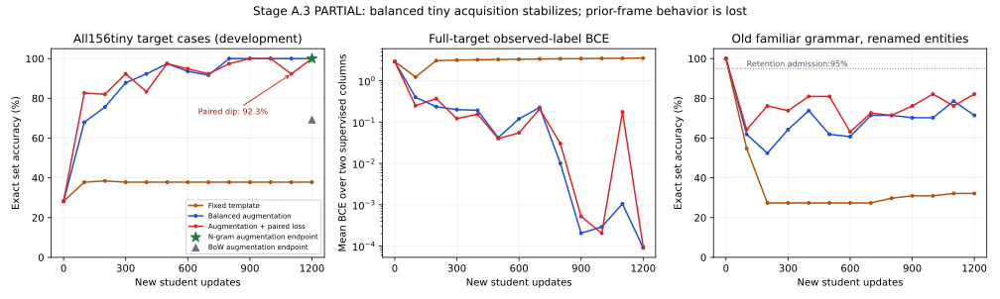

# Stage A.3 — stable basic attribute acquisition

**Final exit: PARTIAL.** Balanced BCE acquires all156tiny training targets stably; old-frame retention fails and paired consistency remains unstable. Final code4e1cc9f passes808remote regressions/16focused contracts. Sealed qualification remains unopened. See the completed-study section below for exact evidence and limitations.

Preflight: clean m104-e-and-m105-a at8cc0f68 (documentation after final tested cbf2f82). Existing all-docs preflight and historical contracts remain binding; current README, tiny.yaml, A.2 report, canonical owner, tokenizer, neural heads, optimizer helpers, remote launchers and tests inspected. Current scope is Stage A.3 development, not a new milestone. M104-E/M105-A historical acceptance reports do not certify language learning. Previous793remote passes/13focused contracts atcbf2f82 and all negative artifacts remain immutable.

LOCAL: lint/type/syntax/mock-only. REMOTE: Kaggle CUDA training, inference, checkpoint checks and full regression. No local neural execution or CPU fallback. All candidate branches continue the same immutable1400-update parent3e93d7238bfdb706ddfd49ee9903fed8b1e6f577529537f1e21cae12e905b262 (weights aed748...). The parent is the continuing historical student, not a promoted failed A.2 checkpoint.

## Prespecified smallest intervention

Hypothesis: fitting a finite set of three frames with exactly balanced semantic/status and surface-factor coverage can distinguish unstable acquisition from grammatical extrapolation. A symmetric cosine-consistency penalty on the existing concept vectors may align equivalent descriptions without adding parameters. It is an experimental objective, never an automatic production policy. Original BCE, clipping, optimizer membership, scheduler/global-step accounting, RNG ownership and default update behavior remain unchanged when the optional objective is absent.

Tiny set: two familiar words (flammable/conductive), independently positive/negated/absent, two familiar names, three new development-training frames, two irrelevant prefixes and both property orders. No synonyms, entity binding or causal rules. At most216generated text cases before deduplication. Every batch covers all nine status pairs with two descriptions each. Every24updates the first-view frame/prefix/order/name factors are exactly balanced per status; second views are a bijective variation with a different frame. Same paired streams and statuses across arms; fixed-template control disables frame/prefix/order variation only. All tiny cases are TRAINING/DEVELOPMENT data, not independent qualification.

Arms, all1200actual updates/batch18/lr.002/decay0/clip1, seed42 feasibility only:

1. fixed/inherited: current BCE, one frame, no prefix/reordering.
2. augmented/inherited: balanced full tiny-set coverage, BCE only.
3. paired/inherited (declared primary): identical augmented stream, BCE +.1mean(1-cosine(existing concept vectors)) for same-status paired views. Both sides receive gradients; no new parameters or teacher/oracle input.
4–6. augmented/backbone moments-only, bias-correction age-only, complete backbone-state reset. Warm-age restart is explicitly non-equivalent Adam initialization; constant LR/no scheduler required, global updates never reset.
7. augmented/concept-and-attribute moments-only, preserving backbone moments/ages and state/transition parameters.
8. augmented/effective-age-preserving rebase, a numerically identical bookkeeping control for arm2.

All branches start with identical inherited weights/optimizer state except the declared optimizer intervention. Retention on the old competent familiar-frame observations is measured before/after, never replayed or used for fitting. No automatic reset is adopted. Baselines: raw observed-text bag-of-words and word1–3gram linear controls, same observations/update budget per main stream; separate parameters and actual wall costs. The inherited Transformer is the neural baseline; no specialist replacement.

Phase1 reports independent one-factor minimal-pair diagnostics for names/prefix/order/frame and same-token positional-ID offsets0/4/16; complete token/mask/position evidence, pooled/concept/last-observation hidden vectors, logits and fixed-regularization linear readout diagnostics. Readouts are auditor tensors fit on tiny TRAINING data only, never attached to student. Track training per-frame exact, per-property precision/recall, explicit-negated/absent correctness and observed-label gradient flow. Same-byte familiarity is not conceptual understanding.

Stable acquisition requires all final three100-update checkpoints (1000/1100/1200) exact>=99%, every frame>=99%, positive/negated/absent correctness>=98%. Prior competent-frame retention must remain>=95% in both old competent cells for qualification admission. No best-step/best-arm selection; primary paired arm is fixed before outcomes. If all three main procedures fail stable fitting, stop and diagnose before any pooling correction. No pooling/capacity/module change is authorized merely to improve a score. A supported later minimal pooling hypothesis would require separately recorded evidence and a matched ablation.

Only if primary feasibility acquisition AND retention converge may a separately frozen protocol introduce independent sealed grammar families and additional learning-stream seeds. Sealed cases/labels are not generated by this feasibility runner. Broad conceptual, causal and learning-to-learn claims stay unqualified even if a lexical attribute task passes. Any subsequent multi-seed qualification requires its own independent families and a fixed protocol before observation.

Each trial stores curves, predictions, actual sampled indices, complete tokens, hashes, optimizer counters, metadata and unpromoted checkpoints. Primary fresh-process reload must preserve predictions and the next sampled update (one extra disposable engineering update per process, excluded from candidate weights/learning metrics). Full suite runs on final source remotely. Budget:900s experiment,240s focused contracts,1200s full suite; isolated output files, immutable parent and scoped Git rollback. No remote result existed at preregistration.

Implementation ready, locally checked:17mock/string-only cases pass across the new tiny fixtures and existing frame mocks; scoped Ruff/Pyright/syntax checks pass. New remote contracts cover default-BCE numerical equivalence, symmetric consistency gradients, contradictory-pair rejection, exact tiny-stream coverage and fresh-process paired-objective continuation. No local neural test was run. Full tiny-target metrics are distinct from actual-delivered training support: fixed sees one-frame subset, augmented/paired see the complete finite set. Auditor readouts fit full tiny DEVELOPMENT support (not sealed or historical shifted data) and are explicitly diagnostic; they do not repair or replace the student's head.

## First remote run: preserved ERROR, no objective-effect qualification

Kaggle amg-stage-a3-stable-attributes/1 at e2f6927:12focused contracts pass and804full regressions pass, but feasibility errors at the exact augmented/rebase end-hash assertion. Both started from identical model/optimizer hashes and same planned stream. Eight provisional training arms are saved; baseline and actual-student restart phases were not reached. Some arms fit the tiny target, but no objective/reset benefit is certified while the no-op identity control fails. The assertion is not weakened. Raw artifacts/checkpoints are immutable; compact provenance is stable_attributes_failed_v1.json. No sealed generation or promotion.

Next bounded GPU diagnostic compares two identical owners in lockstep: exact batch hashes, named parameter-group order, restored identical RNGs, forward outputs, clipped gradients and optimizer/model states at each step (at most100). Default numerics are compared with explicit deterministic algorithms and CUBLAS workspace :4096:8 configured before CUDA initialization in a separate process. Record the first divergent operation/parameter and dispatched operator names. This diagnoses numerical reproducibility before changing the learning intervention, seed, data, budget or gate. Strict-mode failures are evidence, not passes. No numerical-policy change is adopted until the short probe supports it.

## Confirmed numerical repeatability finding and scoped repair

Short Kaggle `amg-stage-a3-numerics/1` COMPLETE at944df2ba8063d193fa18a9576ac05df6d738d154: default CUDA execution first diverges at update11. Named parameter groups, input hashes, initial model/optimizer state, RNGs, forward logits and scalar losses match; WTE gradient differs by7.450580596923828e-9 and weight by1.862645149230957e-9. Explicit deterministic algorithms plus CUBLAS_WORKSPACE_CONFIG=:4096:8 and cudnn benchmarkFalse repeat100updates bit-exactly. Dispatch includes efficient SDPA and embedding backward in both modes; the precise responsible kernel is not isolated, and no specific embedding/attention formula bug is claimed. This is a confirmed scientific reproducibility failure under default numerics, not a missing input or seed mismatch.

The new opt-in canonical numerical policy is declared in checkpoint metadata and checked before each update. A mismatched runtime fails closed; the owner never silently changes global flags. The study/child configure the same policy before learning; the launcher sets CUBLAS workspace before starting Python. Legacy checkpoints without a declaration retain historical behavior, without universal next-update repeatability certification. State rollback remains exact; identical resumed learning additionally requires the supported same-device, same-code **and numerical-policy** contract. No parameter, module or capacity changes.

Numerical erratum `stable_attributes_numerics_v1.json` binds the exact original spec hash and data hash; the original protocol file is unchanged. Seed42,1200updates,18examples, objectives, arms and gates are unchanged. No assertion is weakened and no favorable seed is selected. The default failure/provisional metrics remain immutable. New full-shape deterministic gradient/update regression and mocked runtime-policy guards added;20local mock/string tests pass, scoped static checks pass. At the numerical-repair commit, a final remote rerun was required; its completed result is recorded below.

## Completed deterministic study — exit PARTIAL

**Engineering PASS; stable tiny acquisition demonstrated; independent language/retention qualification NOT achieved.** Kaggle `sparklinghydraulics0/amg-stage-a3-stable-attributes/2` COMPLETE at **4e1cc9fd1b424e5cc1c8974c146d5bb1ac6e5da4**. Python3.13.15, PyTorch2.11.0+cu128, CUDA12.8, Tesla T4. Actual full suite **808passed/0failed/0skipped,638.223s**; focused contracts **16passed,19.743s**. Counts overlap; they are not824unique tests. The original ERROR/v1 and804passes at e2f6927 remain separately preserved.

The unchanged data hash matches v1 exactly. All eight arms start from the same aed748... model hash and f278a7bb... pre-intervention optimizer hash,1,255,636stored parameters /406,762declared trainable parameters. Registered-but-unused components are not claimed active. Each arm applies1200updates/21600presentations, batch18, seed42, and ends at2600lifetime updates. Seed42 denotes a new learning stream from one fixed historical learner, not multiple independent pretrained histories. No new neural module or parameter is introduced.

### Training acquisition and old behavior

There are156unique tiny target descriptions (52per frame). Augmented procedures see all156; fixed sees18unique descriptions from one frame without prefix/reordering. The evaluation over all156is a **development/training target support**, not an independent held-out test. Full-support labels include60positive/96negative cases per property; training batches instead balance all nine status pairs exactly. All final predictions/logits and per-label confusion counts are saved.

| Procedure / optimizer intervention | Actually delivered training exact | Full156target exact | Target exact at1000 /1100 /1200 | Stable gate | Old known-name /renamed-name familiar-frame exact |
| --- | --- | --- | --- | --- | --- |
| Fixed / inherited |100%|37.82%|37.82 /37.82 /37.82%|FAIL|23.81 /32.14%|
| **Balanced augmentation / inherited** |100%|100%|100 /100 /100%|**PASS**|66.67 /71.43%|
| Paired consistency / inherited (primary) |100%|100%|100 /92.31 /100%|FAIL|69.05 /82.14%|
| Augmented / backbone moments zeroed |79.49%|79.49%|97.44 /96.15 /79.49%|FAIL|79.76 /69.05%|
| Augmented / backbone bias-correction age restarted |100%|100%|100 /100 /100%|PASS|83.33 /80.95%|
| Augmented / complete backbone state reset |100%|100%|100 /100 /100%|PASS|77.38 /78.57%|
| Augmented / concept-and-attribute moments zeroed |100%|100%|100 /100 /100%|PASS|64.29 /75.00%|
| Augmented / age-preserving rebase |100%|100%|100 /100 /100%|PASS|66.67 /71.43%|

Every old-frame cell starts at100%. All arms fail the95%retention admission. The known-name old cell reuses historical training support; renamed names test paired robustness within familiar grammar, not independent worlds or lifelong retention. Even losing training-support behavior is a real warning, but these cells do not become broad retention certificates.

Balanced augmentation succeeds with **inherited moments and counters**: no optimizer reset is needed to fit this finite support. Resetting moments can worsen fitting; no reset strategy preserves old behavior above the declared gate. Ordinary inherited WTE/concept/head Adam ages finish2600; age/complete-backbone interventions finish WTE age1200 while concept/head remain2600. The unused state-head age remains200. The global lifetime count never resets. No automatic reset is adopted.

The paired objective's final100%must not hide instability. At1100, frame exact is88.46 /92.31 /96.15%; positive/negated correctness91.67%each (absent100%). Flammable has10false positives; conductive has10false negatives. At1200those errors disappear. Intermediate per-case vectors were not serialized; the exact per-frame/per-label counts and loss are retained, and no missing case-specific1100prediction is fabricated. Paired consistency is an experimental opt-in, **not the recommended default or a qualified improvement**.

At1000/1100/1200, balanced BCE achieves100%in every frame and positive/negated/absent stratum. Each property hasTP60/TN96/FP0/FN0; precision/recall/negative recall100%. Full-support BCE is0.000292 /0.001052 /0.0000904. This establishes reproducible finite-set acquisition, not independent language generalization. Changes in support size, names and family count also distinguish A.3 from the larger A.2 study: do not attribute all cross-study improvement to balance alone.



[All-arm actual curves](figures/stage_a3_curves.csv) include every100-update measurement. Baseline markers in the figure are endpoints, not invented baseline learning curves. The fixed arm's full-target curve includes surfaces it never sees; its actually delivered18-case training support is100%at the final endpoint.

### Actual predictions and strong controls

Selected balanced-BCE final predictions, label/logit order flammable/conductive:

| Observed description | Truth | Prediction | Logits |
| --- | --- | --- | --- |
| `For J, status: not flammable; conductive.` |0,1|0,1|-7.277,8.929|
| `not flammable; conductive. This entry concerns J.` |0,1|0,1|-9.355,9.276|
| `Concerning J, we record not flammable; conductive; entry complete.` |0,1|0,1|-10.368,9.099|
| Old `J has properties: flammable; conductive.` |1,1|1,0|12.244,-6.078|
| Old `Y has properties: flammable; conductive.` |1,1|1,0|11.739,-6.719|

Examples illustrate the aggregate results, not selected acceptance cases. Augmented old known-name conductive recall falls to28.57% (TP8/FN20). On renamed old cases conductive recall is also28.57%. The same familiar property word is usable in trained frames and unreliable in the previously learned ones. The paired arm also makes old errors, e.g. `Description of Y: flammable; not conductive.` becomes0,1instead of1,0 (logits-6.241,8.006). No privileged features enter these predictions.

| Raw-text control / stream | Full156target exact | Parameters | Actual updates /presentations |
| --- | --- | --- | --- |
| BoW /fixed |58.97%|18|1200 /21600|
| BoW /augmented |69.23%|34|1200 /21600|
| Word1–3gram /fixed |89.74%|76|1200 /21600|
| **Word1–3gram /augmented** |**100%**|246|1200 /21600|

Vocabulary/features come only from the respective delivered training text. Observations/updates match; compute and parameters do not. The student exceeds BoW on the augmented training support but ties the much cheaper n-gram control. This is not evidence of deep conceptual, causal or compositional understanding.

### Where frame sensitivity is localized, and what remains unresolved

The initial student scores28.21%on the full target support. One-factor minimal pairs (54saved sequences, including legitimate identity controls when order has no effect on a one-clause description) score27.78%. Keeping tokens fixed and shifting absolute positions+4gives16.67%; +16gives40.74%. Dependence is confirmed but is not monotonic: a constant offset is not a principled repair. Name variations here are J/K, both familiar; novel-name/new-family qualification has not run.

Complete prompts and pool masks are retained. Question pooling includes QUESTION and excludes ANSWER/padding as specified. Manual pooled/concept attribute logits agree exactly with the executed student logits for every final arm. Observed-label gradients flow through intended shared parameters, and optimizer ownership reports missing0/duplicate0/stale0. No new truncation, target-mask, head-disconnection or optimizer-membership defect is confirmed.

Auditor ridge readouts (fixed regularization.01) fit the **full tiny development support**, including surfaces not delivered to the fixed arm. They are not deployed heads or held-out evaluations. Initial pooled/concept/last-observation fit exact is87.18 /80.77 /78.21%, versus the initial executed head28.21%. After balanced training, pooled/concept readouts and the executed head are100%, while last-observation readout is76.92%. Property information is partly accessible upstream at initialization; a sole output-head explanation is not established, and neither is information completely absent. The experiment does not isolate backbone drift from concept-projection/head drift on the old frames. Controlled component ablations would be needed before assigning a unique responsible layer.

Corpus-wide same-status concept cosine increases to.964for balanced BCE (.994for paired), versus different-status means-.008and.250respectively. These means include within- and cross-frame pairs, and statuses with identical binary targets. Higher similarity under paired consistency does not imply better semantic understanding, stable predictions or retention. The paired instability is observed despite its greater same-status cosine.

Because procedure2fits stably, the preregistered condition for procedure4is not met. The last-observation probe is also worse than the existing pool. **No pooling/representation change or extra capacity is justified or implemented.** The strongly supported bottleneck is now preserving and reusing a learned property mapping beyond the newly trained surface support; the precise layer-level cause remains unresolved. Lack of rehearsal/old-support supervision is a design limitation of this trial, not a newly proven architecture defect.

### Persistence, provenance and qualification decision

The augmented and no-op rebase final weight hashes are exactly identical under the declared numerical policy. The new24-step full-shape gradient/model/optimizer regression passes; the earlier short probe repeats100updates. The actual trained paired checkpoint then loads in a **fresh Python process** with identical predictions and identical next sampled update/loss/full state signature. Signature includes parameters, optimizer/scheduler, gradients, trainability/module modes, declared external data/cursor and RNGs. Two disposable extra updates (one per process) are excluded from candidate learning metrics and never saved over the candidate. Candidate file hash stays unchanged. This establishes tested same-code/runtime continuation, not semantic retention across future experiences or cross-version portability.

All210saved new-input sequences (156target+54minimal pairs) round-trip complete rule/question text and marker order; max158tokens within configured256. Every candidate file hash is verified offline; no local checkpoint loading/neural evaluation occurs. Context capacity remains eligible for future explicitly validated evolution. Raw representations, predictions, sampled indices, optimizer counters, gradient diagnostics, actual hashes and runtime policy are retained.

Measured synchronized student-arm wall totals259.484s, controls7.128s. Arm times include periodic evaluation, representation/readout diagnostics and checkpoint I/O, not pure GPU kernel time or claimed compute matching. Final scientific branches total9600updates/172800presentations; four controls total4800updates/86400presentations. They are isolated branches of one historical learner, not one learner accumulating all eight arms. Full-suite638.223s and focused19.743s are separate. The earlier failed study and short numerical probe consumed additional resources and remain recorded; they are not erased from costs/provenance.

**Exit PARTIAL.** Basic finite, multi-frame attribute acquisition works with balanced BCE in this one historical learner/seed. The primary paired intervention fails stability, every arm fails old-frame retention, the n-gram baseline saturates the support, and no independently sealed grammar/name/position evaluation has occurred. Qualification admission is false. No additional learning-stream seeds, sealed cases, synonyms, binding, causal tasks, learning-to-learn or self-modification are launched. No checkpoint is promoted and no milestone advances.

The smallest justified next investigation is inference-only localization of old-frame drift using these saved states, followed by a separately preregistered balanced-BCE/rehearsal comparison using genuine old TRAINING experiences and independent old/new validation descriptions. Existing replay infrastructure should be tested before adding capacity. Do not train on the viewed retention probes and call that retention, or automatically reset moments based on the best single-seed arm. Freeze that future protocol before sealed evaluation. This recommendation is not an additional experiment launched here.

## Revisions, files and reproduction

Source commits: **e2f6927** (tiny curriculum/optional consistency/initial contracts), **944df2b** (preserved ERROR and first-divergence probe), **4e1cc9f** (evidence-supported numerical policy and final tested source). The subsequent evidence commit changes documentation/manifests/figures only; its HEAD must not be mislabeled as the808-test neural-source revision. Historical216c3d5/2e228ea/9431421/cbf2f82and8cc0f68remain ancestors; no historical report or checkpoint is rewritten.

LOCAL: lint/type/syntax/mock-only. Final inspected local selection:

```bash
.venv/bin/python -m pytest -q tests/test_stable_attributes_mock.py tests/test_frame_a2_mock.py tests/test_frame_curriculum_fixtures.py
.venv/bin/ruff check src/adaptive_mini_gpt/training/learning_state.py src/adaptive_mini_gpt/data/stable_attributes.py scripts/run_stable_attributes.py scripts/run_stable_numerics_probe.py tests/test_stable_attributes_mock.py tests/test_stable_attributes_remote.py kaggle/launch_stable_attributes.py kaggle/launch_stable_numerics_probe.py
.venv/bin/ruff format --check src/adaptive_mini_gpt/training/learning_state.py src/adaptive_mini_gpt/data/stable_attributes.py scripts/run_stable_attributes.py scripts/run_stable_numerics_probe.py tests/test_stable_attributes_mock.py tests/test_stable_attributes_remote.py kaggle/launch_stable_attributes.py kaggle/launch_stable_numerics_probe.py
.venv/bin/python -m compileall -q src/adaptive_mini_gpt/training/learning_state.py src/adaptive_mini_gpt/data/stable_attributes.py scripts/run_stable_attributes.py scripts/run_stable_numerics_probe.py tests/test_stable_attributes_mock.py tests/test_stable_attributes_remote.py
```

20mock/string tests pass. Scoped Pyright standard mode reports0errors/0warnings on those eight changed Python files, with Python3.12 and extraPaths `src`, `scripts`, `tests`, `.venv/lib/python3.12/site-packages` (temporary `/tmp/amg-repair-pyright.json`). This does not certify all legacy types; existing CLI YAML type diagnostics remain unchanged. Static plotting uses completed JSON only, with cached temporary matplotlib; no dependency is added and no model is evaluated locally.

REMOTE: Kaggle T4 neural training/full tests. The tracked launcher clones the branch, checks out the exact SHA, verifies CUDA/platform, discovers the immutable parent and bounds every phase. Recreate the final job directory locally without executing any training:

```python
import json
from pathlib import Path
job = Path("runs/kaggle-stage-a3/job")
job.mkdir(parents=True, exist_ok=True)
sha = "4e1cc9fd1b424e5cc1c8974c146d5bb1ac6e5da4"
job.joinpath("launch.py").write_text(
    Path("kaggle/launch_stable_attributes.py").read_text().replace("__PINNED_SHA__", sha)
)
job.joinpath("kernel-metadata.json").write_text(json.dumps({
    "id": "sparklinghydraulics0/amg-stage-a3-stable-attributes",
    "title": "amg-stage-a3-stable-attributes", "code_file": "launch.py",
    "language": "python", "kernel_type": "script", "is_private": True,
    "enable_gpu": True, "enable_tpu": False, "enable_internet": True,
    "dataset_sources": [], "competition_sources": [], "model_sources": [],
    "kernel_sources": ["sparklinghydraulics0/amg-stage-a-diagnostic"]
}, indent=2))
```

Actual network commands:

```bash
kaggle kernels push -p runs/kaggle-stage-a3/job
kaggle kernels status sparklinghydraulics0/amg-stage-a3-stable-attributes
kaggle kernels output sparklinghydraulics0/amg-stage-a3-stable-attributes -p runs/kaggle-stage-a3/output-v2
kaggle kernels push -p runs/kaggle-stage-a3-numerics/job
kaggle kernels output sparklinghydraulics0/amg-stage-a3-numerics -p runs/kaggle-stage-a3-numerics/output-v1
```

The probe launcher is rendered with944df2ba8063d193fa18a9576ac05df6d738d154and its own kernel ID/private metadata. Original rendered v1job files are retained separately at `runs/kaggle-stage-a3/job-v1/`; the current job pins4e1cc9f. Qualified version numbers refer to the recorded completed runs, not future versions created by these rerun commands.

Inside Kaggle/Colab CUDA only, the final scientific entry point is:

```bash
CUBLAS_WORKSPACE_CONFIG=:4096:8 PYTHONPATH=src OMP_NUM_THREADS=2 MKL_NUM_THREADS=2 python scripts/run_stable_attributes.py --root /kaggle/input/<mounted-parent>/inherited_weights_inherited_moments.pt --output-dir /kaggle/working/stable-attributes
CUBLAS_WORKSPACE_CONFIG=:4096:8 AMG_RUN_GPU_TESTS=1 python -m pytest -q --junitxml=/kaggle/working/stable-attributes/full-suite.xml
```

Use the launcher for actual mount discovery; the parent-file hash rejects a wrong mount or fresh fallback. Runners abort outside a remote CUDA runtime. Probe modes remove/set the workspace variable in separate child environments and record the first divergence; do not infer determinism from seeding alone.

Evidence paths:

- ERRORv1: `runs/kaggle-stage-a3/output-v1/stable-attributes/`; [compact preserved failure](../data/manifests/stable_attributes_failed_v1.json).
- COMPLETE numerical probe: `runs/kaggle-stage-a3-numerics/output-v1/numerics-probe/`; [full short-probe measurements/hashes](../data/manifests/stable_attributes_numerics_probe_v1.json).
- COMPLETEv2: `runs/kaggle-stage-a3/output-v2/stable-attributes/`; [compact final provenance/metrics](../data/manifests/stable_attributes_v2.json).
- Derived saved-prediction CSV: `runs/kaggle-stage-a3/analysis-v2/predictions.csv`; [tracked actual curves](figures/stage_a3_curves.csv).

Large raw checkpoints/vectors/predictions are ignored artifacts, not removed failures. Both model-file and raw-output hashes are retained; no local checkpoint load is used to verify them. All old artifacts remain in place. Rollback is the untouched historical parent, isolated unpromoted outputs and scoped Git reversion. Unsupported structural operations and automatic optimizer resets remain disabled.

Exact changed files since8cc0f68:

```text
README.md
data/manifests/stable_attributes_failed_v1.json
data/manifests/stable_attributes_numerics_probe_v1.json
data/manifests/stable_attributes_v2.json
data/specs/stable_attributes_numerics_v1.json
data/specs/stable_attributes_v1.json
docs/04-experiments.md
docs/05-roadmap.md
docs/06-data-pipeline.md
docs/CANONICAL_LEARNING.md
docs/FOUNDATION_DEFECT_REGISTER.md
docs/STAGE_A3.md
docs/figures/stage_a3_curves.csv
docs/figures/stage_a3_curves.svg
kaggle/launch_stable_attributes.py
kaggle/launch_stable_numerics_probe.py
scripts/run_stable_attributes.py
scripts/run_stable_numerics_probe.py
src/adaptive_mini_gpt/data/stable_attributes.py
src/adaptive_mini_gpt/training/learning_state.py
tests/test_stable_attributes_mock.py
tests/test_stable_attributes_remote.py
```
