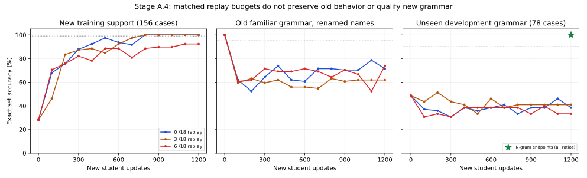

# Stage A.4 — knowledge preservation and reusable concepts

Preflight: branch `m104-e-and-m105-a`, clean at `323845f`; verified neural core `4e1cc9f`. The earlier full repository/document preflight and historical contracts remain binding; current A.3 evidence, input/optimizer/checkpoint code, data manifests, old training fixture and remote workflows were reviewed. This is Stage A.4 foundation work, not a new milestone. Existing acceptance gates (A.3 stable fitting over updates 1000/1100/1200 and >=95% old-frame observations) remain unchanged. No sealed testing, architecture growth, automatic optimizer reset or candidate promotion is authorized without prerequisites.

LOCAL: lint/type/syntax/mock-only. REMOTE: Kaggle CUDA inference, training, restart/retention and full regression. No local neural execution or CPU fallback.

## Prespecified sequential plan

1. **Inference-only localization first.** Compare the immutable pre-A.3 parent (file SHA256 `3e93d7238bfdb706ddfd49ee9903fed8b1e6f577529537f1e21cae12e905b262`) with the unpromoted A.3 balanced-BCE final checkpoint (`02dcbe3feedd975df34222b2a5a38e0481bedc7a52fe56dff7d655bb14c7adf3`). Evaluate the two old development cells and all 156 A.3 training descriptions. Record full tokens, logits, per-property metrics and representations at token embeddings, Transformer output, pooled vector, concept projection and head. In isolated diagnostic-only copies, swap embedding, position embedding, frozen lower blocks, trainable top block, final norm, concept projection and attribute head individually in both directions; also swap entire backbone and entire bottleneck as interaction controls. Check topology/shape/alias compatibility; verify originals' hashes untouched. A swapped composite is not a deployable learner and may create incompatible feature bases: effects identify correlations, not unique causation. No optimizer step, backward call or training may run in this phase.
2. **Replay feasibility only after phase 1 completes.** Use the same pre-A.3 persistent parent, selective backbone and balanced two-label BCE (no paired loss and no reset). Compare exactly 0/3/6 replay examples per batch of 18, fixed 1200 updates, LR .002, decay 0, clip 1 and seed 42. This is 0%, 16.67% and 33.33% replay under identical total update/example budgets, with explicit reduced new-example exposure (21600/18000/14400) and replay exposure (0/3600/7200). The replay examples are only the nine `Object A` records actually used in historical Stage A training (`data/fixtures/stage_a_original_tiny.json`, source 216c3d5); their source/label hash and exact question strings must be checked against every viewed retention probe, prior state-training retention fixture, and new training set before any update. Fail closed on overlap. For each replaced slot, use its matching observed status pair, keeping the batch label distribution fixed. A fixed 33.33% primary is declared before results; no best-step or best-arm selection using final holdouts. Record every sampled source/index, full tokens, optimizer/state hashes, per-label outcomes, resource costs and 100-step learning/old-behavior curves. Keep old/new evaluation metrics distinct and all candidates unpromoted.
3. **Conditional selective/modular comparison.** If replay fails the unchanged acquisition+retention gates, assess the phase-1 evidence and existing supported adaptation paths. Compare selective updates and existing modules only if an actual compatible active path can be identified without adding parameters; otherwise document precisely why this is unsupported. Do not silently substitute a new module or discard useful state.
4. **Qualification remains sealed.** Only after the fixed primary has stable new-support acquisition AND >=95% in both old development cells may a separately frozen protocol generate new names/grammar/attribute combinations and run multiple learning streams with strong lexical and neural controls. All current cells were previously viewed; they are developmental, not sealed tests. No held-out data drives training or checkpoint selection. Passing a lexical task is not causal or general conceptual understanding.

All runs use explicit deterministic CUDA numerical policy and exact same-code/runtime checkpoint contracts; source, seed, manifests, checkpoint hashes and actual costs are recorded. Baseline budget is finite: 300 s inference, 900 s replay, 1200 s full regression, plus focused checks. Rollback is the untouched parent, isolated diagnostic/candidate copies and scoped Git reversion. No training has been submitted at preregistration.

## Phase 1 result — completed before any A.4 training

Kaggle `sparklinghydraulics0/amg-stage-a4-localization/1` COMPLETE at `6f3c2046d0ec26c1aac7296942f4440d79789945`. Same Tesla T4 / Python3.13.15 / PyTorch2.11.0+cu128 / CUDA12.8; synchronized inference/inspection wall 5.277 s. Zero optimizer steps, gradients or training. Input file SHA256 values and model tensor hashes remain unchanged; compatible topology/dtype and tied embedding alias verified. Artifacts: `runs/kaggle-stage-a4-localization/output-v1/a4-localization/`; compact hashes/metrics: `data/manifests/a4_localization_v1.json`.

| Isolated inference model | Old known | Old renamed | New training support |
| --- | --- | --- | --- |
| Pre-A.3 parent |100%|100%|28.21%|
| Post-A.3 balanced BCE |66.67%|71.43%|100%|
| Post model with entire pre backbone |100%|100%|21.79%|
| Pre model with entire post backbone |52.38%|50.00%|73.72%|
| Post model with pre token embeddings |42.86%|42.86%|76.92%|
| Post model with pre top block |54.76%|50.00%|24.36%|
| Post model with pre concept projection |54.76%|52.38%|76.92%|
| Post model with pre attribute head |69.05%|69.05%|100%|

Restoring the entire earlier backbone recovers both old-frame cells in the post model, but loses the new support; inserting the post backbone into the pre model substantially harms the old cells. The pre model with the post attribute head retains100%/98.81% old accuracy, so head changes alone do not explain the degradation in that pre-backbone context. These results **implicate changes to the shared backbone and its interactions with the learned projection/head**, without assigning a unique causal component. Swapping token embeddings, top block or concept projection alone often worsens both tasks, consistent with cross-version feature incompatibility; hybrids are diagnostic, never candidates for promotion.

Position-embedding and frozen-lower-block weights have exactly zero measured drift; replacing either is a no-op for measured outputs. WTE/top block/final norm/concept projection/head weight differences are nonzero and recorded by tensor. Full input token sequences, embedding and position-summed pooled vectors, Transformer outputs, concept vectors, per-property confusion counts and actual logits/predictions are preserved. This is correlation under surgical intervention, not proof that a particular CUDA operation or one weight tensor uniquely caused forgetting.

The original nine `Object A` descriptions are documented actual old TRAINING data, separate from the previously viewed J/K/Y/Z retention descriptions and the prior state-probe fixture. Replay must fail closed unless runtime verifies exact text/label isolation from all known retention/probe and new-support strings; these nine are not used as retention evaluation. The old known-name retention cell itself was historically training support; the renamed cell is a paired familiar-grammar probe, not an independent-world certificate. Phase 2 is now authorized by the completed inspection.

Phase 2 adds three disjoint **development** grammar families on familiar names (never sealed) to diagnose generalization; none enters optimizer batches or replay. Qualification admission also preserves the existing A.2 development requirements: exact >=90%, each family >=85%, and each positive/negated/absent stratum >=95%, alongside the unchanged A.3 stable-support and old-frame >=95% requirements. This adds no weaker threshold and does not make developmental results sealed evidence. The moderate-replay arm is the sole fixed primary. Raw historical fixture SHA256 is `130dc05e42ed9ee0c1122dd95532a16562fc67f5ffa95422f099eff48643f1e5`.

Phase 2 implementation: the exact source fixture is verified, then compared against all four historical factorial cells, the A.2 development sets, A.3 minimal/training examples, earlier attribute holdouts, and the prior state-retention fixture; any normalized exact-text overlap aborts before updating. Historical `tiny` remains a training subset and is not misclassified as a heldout probe. The additional development templates are also checked for exact-text overlap with previous probes and both training supports. Every replaced replay slot preserves its original independently annotated status pair, so label composition is matched, while actual new/replay examples and token counts remain separately recorded. The replay stream and curated historical examples are owned by the continuing `LearningState`; no model receives hidden status metadata at inference. The launcher refuses any training unless the completed inference-only inspection is recorded. The frozen-backbone and legacy domain-adapter paths remain for a conditional phase 3 decision after results.

LOCAL inspection: 12 tiny fake/string cases pass across the new replay mocks and existing stable-objective mocks. Scoped Ruff/type/syntax checks cover the new driver, data module, launcher and tests. Real model operations and full regression are REMOTE only; no phase-2 result exists yet.

Saved representations also permit a descriptive pre/post comparison without loading a model locally. Across old known-name cases, the mean per-case L2 difference is 0.0707 for question-span mean token embeddings, 1.3334 for final pooled Transformer vectors, 9.9340 after the concept projection and 9.2882 for the two logits. These vector spaces have different dimensions/scales; the numbers cannot rank causal importance. Full values and renamed/new distributions are in `data/manifests/a4_representation_summary_v1.json`. All 324saved rule/question sequences round-trip with markers intact; max 158 tokens within the model's 256-token experimental context.

## Phase 2 result — replay prerequisites failed

Kaggle `sparklinghydraulics0/amg-stage-a4-replay/1` COMPLETE at `4afeffce617d3b32a9b8b7c58c3f22e9a697b562`; 812 remote regressions passed, 5 focused contracts passed, 0 skipped/failed. Deterministic CUDA execution, same source/runtime policy, model and optimizer ownership all verified. The no-replay final weight hash exactly reproduces A.3 balanced BCE; moderate-replay checkpoint predictions and next sampled update/state reproduce in a fresh process. All three start from identical parent weight/optimizer hashes and remain unpromoted.

| Replay /18 | New support exact | Stable support gate | Old known / renamed | Unseen development grammar | New / replay presentations |
| --- | --- | --- | --- | --- | --- |
| 0 |100%|PASS|66.67% /71.43%|38.46%|21600 /0|
| 3 |100%|PASS|64.29% /61.90%|41.03%|18000 /3600|
| 6 (fixed primary) |92.31%|FAIL|73.81% /73.81%|33.33%|14400 /7200|

All old-frame cells begin at100%, all arms fail the95%old-observation gate, and all development grammar results fail the unchanged90%exact/85%per-family/95%per-status requirements. The fixed primary also fails the last-three-checkpoint support stability gate. The no-replay arm's final old/new weights reproduce the prior A.3 result exactly; no favorable step is selected (e.g. 1100-update old-known 80.95% is not the 1200-update endpoint). The complete curves, per-property counts, actual examples, sampled index sequences and tokens are preserved in the raw artifact and `data/manifests/a4_replay_v1.json`. No seal is generated.

All ratios present exactly2400examples of each of the nine status pairs. Each sees all156new descriptions; replay arms see all nine historical descriptions. The parent scores only11.11%on those nine at the start: they were genuinely **encountered historical training examples**, but current competence on them was not established. Replay arms fit those nine to100%; that is training-set relearning, not certified retention. The separately evaluated old-known cell was previous training support; the renamed old cell is a correlated familiar-grammar probe. Neither is independent world retention.

The moderate-replay developmental flammable recall is13.33% (TP4/FN26), and conductive recall33.33% (TP10/FN20). On the old-known cell, flammable recall is50% (TP14/FN14). Actual examples: `A note on J lists flammable; conductive.` has truth1,1 but moderate replay predicts0,0 (logits-7.594,-3.219); `For J, status: not conductive; flammable.` has truth1,0 but predicts0,1 (logits-1.555,1.401). The strong word1–3gram control scores100%on the unseen development grammars in all three arms, while the fresh BoW controls score69.23–82.05%; the linear controls lack the neural student's prior history, so they are text baselines, not matched continual-history controls. Their costs/parameters are recorded separately.

Measured student-arm synchronized wall time totals100.17s and six lexical controls11.54s; these figures include evaluation/host work and are not pure GPU-kernel time. Exact nonpadding tokens are 2,743,200 /2,667,691 /2,591,852 respectively; equal presentation/update budgets do not imply equal token or compute budgets. Each branch continues the same historical checkpoint independently. The stage declares a new RNG stream at its boundary; it does not claim retrospective exact resumption of the historical RNG. All399saved new/old/development token sequences decode completely; raw prior old-frame sequences are independently preserved by phase 1. No checkpoint is promoted.

## Conditional phase 3 — preregistered after replay failure

The full-backbone swap in phase 1 restored old behavior, motivating a **temporary frozen-backbone** control. Start from the identical historical parent and optimizer state; use exactly the predeclared 6/18 replay stream, two-label BCE, 1200updates, seed42, LR/clip, datasets and gates from phase 2. Freeze the existing student backbone using the canonical `set_mode('frozen_backbone')`; train the existing concept projection/attribute head. Verify that every named optimizer state remains identical across the trainability transition, all live parameters remain registered, and initial predictions and backbone tensors are unchanged. Compare directly to phase-2 selective 6/18 and the no-replay selective baseline; report active/trainable counts and actual compute separately. Frozen is a study control, not a permanent architecture ceiling. Fixed phase-3 primary: frozen-backbone 6/18; no best-checkpoint selection.

For the existing modular control, first switch a disposable copy to the already-implemented entity-conditioned attention extraction path (ECA), without new parameters. Test old pre-update competence; only if both old cells are >=95% may an ECA/frozen-backbone 6/18 learning arm run. If activation itself fails this gate, record its exact predictions and mark modular retention **not qualified / training skipped**. ECA is an existing auxiliary path, not a domain adapter; the registered domain residual adapters are used by `TextStudentM103.forward_lm` but bypassed by the active attribute path. Adding a new adapter connection or gating mechanism merely to manufacture a comparison is outside this study. All models remain isolated/unpromoted. If the fixed frozen primary misses any unchanged gate, stop before sealed qualification.

Phase 3 implementation preserves every named Adam state through the freeze/unfreeze transition and rejects any missing/duplicate/stale optimizer registration. It checks old predictions immediately before training, exact frozen-backbone parameter hashes and dormant optimizer states after training, actual active gradient paths, stored/trainable parameter counts, and fresh-process continuation. The existing ECA strategy is evaluated on a disposable copy with the same tensors; if old competence fails at activation its training is skipped. The fixed primary is frozen-backbone with six historical examples per batch. LOCAL: 13 inspected mock/string tests pass; scoped Ruff/Pyright/syntax checks pass. No phase-3 model result has been produced at preregistration.
