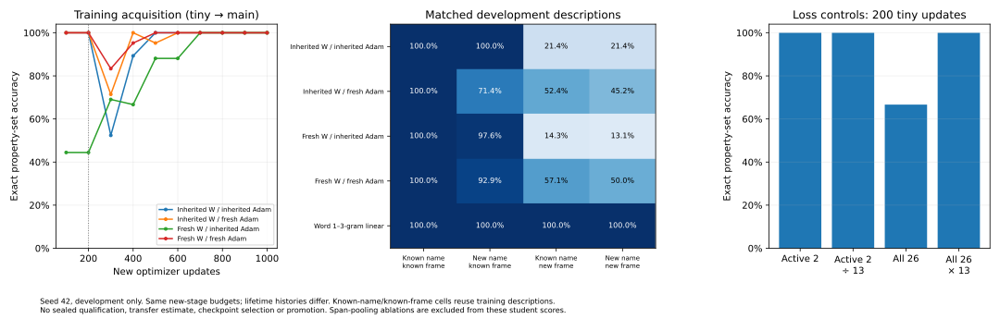

# Stage A development diagnostics and FP16 repair

Final verdict: **engineering PASS, learning FAIL; not ready for new sealed qualification**. The17d8c6f neural core passes781remote tests. The continuing candidate gets100% on familiar frames and21.43% on unfamiliar frames, versus n-gram100% throughout. Resetting inherited backbone Adam state fixes the original tiny acquisition endpoint, but no model or optimizer candidate is promoted. All historical failures and exact source scopes are retained below.

Preflight: clean `m104-e-and-m105-a` at `2e228ea`. Preserve `216c3d5`, `2e228ea`, prior checkpoints and failed artifacts. Current scope is Stage A foundation diagnosis, not a new milestone. No `reports/` directory exists; latest report is ATTRIBUTE_LEARNING.md. Previously reviewed docs/*.md, tiny.yaml and active contracts remain applicable. No structural changes or new semantic capacity.

## Prespecified implementation and finite plan

1. Trace old production CLI on pinned2e228ea before changing its math: explicit ambient seeds42/43, configured seed42; record initialization tensor hash, actual Adam calls/counters, scaler scales before/after, scheduler epochs and full saved checkpoint summaries. Save both first/resumed checkpoints even when old qualifier fails. A historical failure is not a pass; injected overflow separately establishes update accounting without relying on a lucky natural seed.
2. Minimal repair: seed before model construction; count successful optimizer updates independently of attempts/skips; step scheduler only after actual Adam call; persist counters and reject ambiguous legacy progress rather than silently certify it. Keep the recovery assertion that every applicable Adam counter is4. Bound consecutive overflow retries. Add inspected mock and remote neural regressions. Full suite remotely only.
3. Development-only learning: unchanged existing dense student and two observed labels, lr.002/decay0/clip1/seed42,200tiny+800main updates, batch<=16. Four cells cross familiar/novel names and familiar/novel templates with exactly matched property annotations/content, order and negation operator. Use new development grammar/names, no old heldout cases. Familiar/familiar deliberately includes training descriptions; no independent sealed qualification claim.
4. Continue latest failed Stage A checkpoint as the primary candidate, preserving its400-step history. Controlled2x2: fresh vs inherited weights crossed with fresh vs inherited Adam states, explicitly mapped by parameter names. All get identical new observations/steps. Additional200-update reproduction from original200-step historical parent on original TRAINING tiny examples checks88.9%, never old heldout labels. These are isolated mechanism controls, not specialists/promoted students, and do not budget-match entire histories or qualify transfer.
5. Loss diagnosis: same fresh initialization and200tiny updates, compare active2 BCE, active2/13 (scale only), all26 BCE and13*all26 BCE (restore active gradient scale plus inactive interference). Record active/inactive/shared gradient norms and cosine, per-label loss/logits/predictions, optimizer membership and frozen/trainable flow. No threshold/hyperparameter selection.
6. At fixed endpoints export complete tokens, four-way predictions, pooled/concept representations and matched shifts; inspect causal attention probabilities from the unchanged last-layer Q/K, validate reconstruction against actual attention output, and export token-region mass/pooling weights. Any annotated content-span pooling is explicitly a diagnostic ablation, not deployed performance or oracle concept features.
7. Strong n-gram linear control receives raw observed descriptions, training-only feature vocabulary and same new-stage1000update ceiling. No oracle attributes enter neural or lexical inference. All cases are development only; no untouched final test is used for tuning.

Budget: historical backend trace<=240s; repaired focused checks<=300s; Stage A diagnostics<=600s; full suite<=1200s on Kaggle T4. Commit/push before pinned remote jobs. LOCAL: lint/type/syntax/mock-only. REMOTE: all neural evaluations, backward/updates, checkpoint tests and full suite. No CPU fallback. Rollback: immutable input checkpoints, isolated unpromoted candidate output directories, scoped Git revert. Stop if acquisition or wording independence remains unresolved; no Stage B, capacity increase or milestone promotion.

Engineering PASS requires historical defect evidence, repaired exact optimizer/scheduler/scaler/counter continuation and clean full regression. Learning PASS requires reproducible acquisition and independently useful generalization; these development diagnostics alone cannot qualify a new sealed milestone. Keep negative results and remaining confounds explicit.

Development template construction also controls byte-token exposure: unfamiliar frames use lowercase function words and known punctuation, and the runner rejects any unseen byte ID in the familiar-name/novel-template cell. New Y/Z names can introduce new byte IDs; this is recorded separately. This distinguishes grammatical framing from untrained token rows without modifying tokenization or the network. All choices are fixed before development results.

The diagnostic-only scalar loss multiplier extends the existing owner's update method with default1.0 (unchanged computation in the default branch). Remote gradient regression verifies proportional gradients before clipping; actual experiments keep clipping1 and report unscaled gradient norms. Because this is an active update API extension, the development job also runs full regression at its exact source, separately from the backend-only full-suite revision. Each full suite has its own1200s cap.

For mechanism diagnosis, all four history arms receive the same fixed1000new-update budget even if their200-update tiny score is weak. This is a prespecified Stage A development intervention to remove unequal stopping budgets, not relaxation of the original qualification gate or permission to advance. Tiny failure remains visible; no failed candidate is promoted.

## Backend evidence and repair

Historical trace kernel `sparklinghydraulics0/amg-fp16-diagnostic/1` COMPLETE, instrumentation source16903506f433f488b2d26b0a95e9723c852a4e4c, historical implementation2e228eac41f7541bdf5bb97245e1359d6e1a0024. Tesla T4. All traces/checkpoints remain under `runs/kaggle-fp16-diagnostic/output-v1/fp16-diagnostic/`; hashes/summaries in `data/manifests/fp16_diagnostic_v1.json`.

The ordinary unseeded GPU qualifier PASSED on this repeat. Both prespecified ambient42/43 traces without injection also passed. This does not erase the prior773pass/1fail run, nor establish the exact overflow history of its lost temporary checkpoint. No seeds were added to search for a natural failure.

One injected first-step overflow deterministically reproduces the same strict recovery mismatch: after two old attempted updates, checkpoint global step2, Adam step1, scheduler epoch2, scaler65536->32768. After resume, global4, Adam3, scheduler4, scaler32768. The old optimizer/scaler **did resume** (Adam1->3); global progress and scheduler advancement incorrectly treated the skipped update as applied. Thus the recovery assertion can fail even when restoration itself works. The original failed run's precise counter/scaler values remain unavailable; this distinction is retained.

Configured seed42 did not determine old initialization: ambient42 tensor hash `34eaa547629638e39bbce31f8e224144a72981889e54e33488142c6423f12074`; ambient43 `152f4d947641ba501b6e9f95da722e97c42abea16e4b76b1fb2db979aff750ab`. A pure mock reproducer also failed before repair because model construction occurred without a prior seed call.

Minimal repair source **db9ef688dd00ef63ce6bfc1d606a71cace507bff**:

- CLI applies the configured seed before constructing weights. Trainer still initializes training RNG separately; checkpoint restore subsequently reinstates saved RNG. Both ambient42/43 now produce the same34eaa initialization under configured42.
- `Trainer._apply_update` temporarily observes an actual optimizer post-step hook, removes it before checkpointing, and advances `step`/scheduler only after an applied call. Scaler decisions are not inferred from loss alone or private GradScaler fields.
- Persist `applied_updates`, `attempted_updates`, `skipped_updates`, consecutive skips, consumed tokens and data position. Global/max_steps now mean applied updates. Failed attempts still consume observations and tokens. Skip telemetry records scales before/after and scheduler epoch.
- Bound consecutive skips (default16); exhaustion raises and publishes a forensic `failed_amp.pt`, never successful qualification. Such failure files are not qualified learner promotions. Legacy checkpoints whose global/Adam counters disagree fail closed pending explicit migration; no historical file is overwritten or silently relabelled. Explicit new-dataset CLI resets also reset new counters along with the existing stage reset.
- Keep the strict qualifier assertion that applicable Adam counters equal4. Its token check now uses recorded consumed attempts, because FP16 retries consume real data. Export `checkpoint-progress.json` before assertions; do not discard the states needed to diagnose failures.

Kaggle `sparklinghydraulics0/amg-backend-repair/1` **COMPLETE**: **13 focused checks passed in32.68s;778 full-suite tests passed,0failed,0skipped in626.40s** (one pre-existing docstring warning). Forced repair trace: first checkpoint2applied/3attempts/1skip, Adam2, scheduler2, scale32768,192tokens; resumed4applied/5attempts/1skip, Adam4, scheduler4, scale32768,320tokens. Natural traces2/4applied require2/4attempts, scales65536. No optimizer assertion was weakened.

A separate remote regression injects overflow and interrupts a fixed four-update cosine schedule at two applied updates, then verifies bit-exact final model, optimizer, scheduler and scaler against uninterrupted training. The CLI trace changes max_steps2->4, so it is counter/persistence telemetry rather than a claim of identical cosine trajectories across different configured horizons. The regression holds that horizon fixed.

Artifacts: `runs/kaggle-backend-repair/output-v1/backend-repair/`; manifest `data/manifests/backend_repair_v1.json`. This is **engineering PASS within tested scope**, not neural learning PASS or universal legacy-runner certification.

## Development submission provenance

Source **17d8c6f3aba083b43abc9251e0a27108e511b6d9**. Kaggle diagnostic version1 ERROR: Kaggle refused the ERROR-status Stage A kernel as an input source; contracts passed, then the missing-parent guard stopped before development training. Preserve `runs/kaggle-stage-a-diagnostic/output-v1/` and the submission warning; no fresh fallback occurred.

Use the specific private checkpoint-resume workflow documented in06-kaggle.md, distinct from corpus/data package creation: private `sparklinghydraulics0/amg-stage-a-continuation`, version1, contains only `continuing_selective_two.pt` and its provenance manifest (plus dataset metadata), file SHA2569b4d8a937e553c9d27befbd218612724e5fb43909f632f8ebbb988ed224c4f3e. No repository, environment, credentials, corpus or heldout answers are included. Original parent remains attached from COMPLETE concept-binding kernel. Source manifests and strict runtime file hashes pin both inputs. Dataset provenance: `data/manifests/stage_a_continuation_v1.json`. The expired cached Kaggle OAuth access token was refreshed through the existing SDK session without exposing tokens or putting credentials in jobs; the dataset reports ready. Same source, corrected input, resubmitted as diagnostic version2. Submission alone is not a result.

## Original tiny-case follow-up (development only, fixed before its results)

The four-way development experiment reproduced the original88.89% result/hash, but its optimizer2x2 used new templates and the later400-update checkpoint. It cannot by itself explain why the original200-update checkpoint missed one of the original9 training cases. Complete this requested mechanism question with one120s-max remote job: original200-update parent, same9 TRAINING cases, seed42,200newupdates, two observed labels, lr.002/decay0/clip1. Six declared arms: inherited/fresh weights crossed with inherited/fresh Adam state, plus inherited weights with only semantic-projection/attribute-head state cleared or only backbone state cleared. All state interventions retain parameter values and name-identical optimizer registration; the primary full-inheritance historical reproduction remains untouched. Export each starting prediction/gradient,50-step curve, final prediction/gradient and immutable checkpoint. No old heldout, new development probes, candidate selection, extra modules or qualification. Adam-state effects include moments AND per-parameter step clocks; do not call this isolated moment-value causality or matched-history negative transfer. No broader experiment follows the unresolved template failure.

## Completed development result: learning FAIL

Kaggle `sparklinghydraulics0/amg-stage-a-diagnostic/2` COMPLETE at **17d8c6f3aba083b43abc9251e0a27108e511b6d9**, Tesla T4 / Python3.13.15 / PyTorch2.11.0+cu128 / CUDA12.8. **26 focused contracts passed in18.71s;781 full-suite tests passed,0failed,0skipped in603.83s.** This includes the scalar-loss gradient regression and supported topology/restart contracts. The study uses the canonical update owner without AMP; its learning failures are separate from the repaired FP16 backend.

### Four-way surface-factor comparison

Exact property-set accuracy at the fixed1000-new-update endpoint:

| Weights / Adam state | Tiny200 | Main train | Familiar name / familiar frame | Novel name / familiar frame | Familiar name / novel frame | Novel name / novel frame |
| --- | --- | --- | --- | --- | --- | --- |
| Inherited / inherited: continuing candidate |100%|100%|100%|100%|21.43%|21.43%|
| Inherited / fresh |100%|100%|100%|71.43%|52.38%|45.24%|
| Fresh / inherited |44.44%|100%|100%|97.62%|14.29%|13.10%|
| Fresh / fresh |100%|100%|100%|92.86%|57.14%|50.00%|
| Word1–3-gram linear |not recorded at200|100%|100%|100%|100%|100%|

Each cell has84 matched descriptions over9 annotation families; familiar/familiar deliberately reuses main training descriptions. Each neural arm receives1000new updates,14600examples and the same sampler stream; all remain in Stage A even when the diagnostic tiny phase fails. Stored student capacity stays1,255,636, registered trainable406,762 in all four arms. New-stage nonpadding token totals are in the manifest. Synchronized training/evaluation/inspection intervals:16.82/16.63/16.78/16.89s; these exclude initial gradient inspection and checkpoint I/O and are not total device-event GPU time. N-gram103features uses1000updates/14600examples and1.36s synchronized processing time. Compute is reported, not represented as equal. No model growth or semantic module was added.

Primary candidate starts from the exact400-update archived student and preserves its weights, Adam state and declared memory/history. Its output has1400recorded lifetime updates and is **not promoted**. Fresh/reset-state arms are isolated mechanism interventions, not persistent specialists. Moment transplantation is name-order verified. Inherited active-path states initially have400updates; nine idle transition-path states retain200. Adam-state interventions include step clocks as well as moment values. Equal new-stage budgets are not equal lifetime learning histories and do not qualify positive or negative transfer.

All429 delivered rule/description token sequences independently decoded from the remote artifacts match exactly; maximum155/256tokens. Data SHA256 `c2f7f254a540367f037f60f1832e1dc7c6a4fe9d5c3267f5f1d9fdaf7ff08ffb`. Templates introduce **zero** unseen token IDs with familiar names. Only novel-name cells introduce byte89/90 (`Y`,`Z`). Contrast the retired Stage A split, whose novel names introduced85/86 and combined shift additionally introduced comma44,`F`70,`T`84,`W`87,`X`88. Old byte novelty was a real confound, but is **not necessary** for the new failure: known-byte template changes still destroy predictions. No old heldout example is used to train/tune this experiment.

Changing only the grammatical/lexical frame while holding name, property content and labels fixed causally changes primary exact accuracy100%->21.43%. Both unseen frames fail (33.33% and9.52% exact). Novel entity-token IDs alone are not fatal for this primary candidate (100% with known frames). This establishes frame dependence, not an architectural size ceiling. Frame novelty includes unfamiliar function words/order/positions; it is not an isolated proof about abstract syntax alone.

### Predictions, hidden states and pooling

The previous phenomenon of every positive vanishing is **not a universal fixed output collapse**. In the new primary candidate, novel-frame positive accuracy is89.29%, but negated and absent-property accuracies are both25%: many negatives become false positives. With both name/frame novelty, positive91.07%, negated25%, absent28.13%. Resetting Adam changes the error direction: inherited weights/fresh Adam gives positive28.57% on familiar-name/new-frame cases, while fresh/fresh gives50%. Thus low aggregate performance can hide opposite errors; it is not repaired by a class-zero fallback or one threshold adjustment.

Example matched affirmative input for primary: `J has properties: flammable; conductive.` -> `[1,1]`, logits `[12.40774,7.29504]`; `properties for J include flammable; conductive.` -> `[1,1]`, logits `[4.75277,9.54894]`. Both are correct, yet the latter frame fails most absent/negated combinations. All actual per-label predictions/logits and descriptions are exported, including these failures, in `data/manifests/stage_a_diagnostic_v1_predictions.csv`. Confusion counts, positive/negative BCE and analytical unreduced output-loss derivatives from completed logits are in `stage_a_diagnostic_v1_per_label.csv`; no local neural evaluation produced these tables.

Matched primary pooled cosine averages0.9924 for names alone versus0.6042 for frames alone. After the existing nonlinear concept projection these become0.9807 and-0.00845. Fresh/fresh shows smaller pooled shift(0.9310) but concept cosine0.4556 under new frames. These are measured representation changes on identical properties, consistent with frame-sensitive coding; cosine alone does not prove which layer is defective or that information is absent.

The attention inspector reconstructs the unchanged last-layer causal SDPA output from actual Q/K/V, maximum absolute difference **1.526e-5**. No attention behavior is replaced during training/prediction. In one primary affirmative pair, mean last-layer attention from pooled queries assigns~89.85% to rule bytes and7.26% to property bytes in the known frame, versus89.20%/5.38% in a new frame. Full token-region masses and pooling boundaries are retained. These weights are inspections, not causal importance measures: residual streams and earlier layers can carry information despite low final attention mass.

An explicitly annotated observed-content-span pooling ablation uses the SAME hidden states/projection/head and no attribute truth as an input. It is diagnostic-only, uses generator-provided text boundaries and is never deployed or scored as student competence. Primary exact accuracy becomes9.52% even on known-frame examples and10.71% on familiar-name/new-frame examples; fresh/fresh14.29% on the latter. Therefore a simple inference-time crop/pooling replacement is **not supported**. This ablation changes the distribution seen by a trained head; its failure does not prove pooling is irrelevant or backbone features lack all property information. No new extractor is added.

A sharper matched negation example: `Description of J: not flammable; not conductive.` predicts `[0,0]` (logits `[-11.77598,-8.66061]`), while `regarding J: its listed properties are not flammable; not conductive.` predicts `[1,1]` (`[13.04941,6.59923]`). All42known-name cases in that second frame predict both traits present, regardless of content. This is a frame-conditioned default in the current candidate; it complements the previous all-absent failure rather than erasing it.

### Loss normalization and gradient interference

All active parameters are registered, intended frozen parameters remain frozen, and active/inactive gradient flow by parameter name is recorded. Unused ECA/state paths are not falsely certified as contributing. Existing head/action/transition integration and label indexing are unchanged. Observed attribute IDs are10and15; there is no invented state target.

Same initialization, same9 development tiny cases,200updates:

| Objective | Exact | Active two-label BCE at endpoint |
| --- | --- | --- |
| Two observed labels |100%|0.000641|
| Same two-label loss divided by13 |100%|0.000953|
| All26-label BCE |66.67%|0.319616|
| All26-label BCE multiplied by13 |100%|0.001654|

Repeated two-label training reproduces the exact200-update tensor hash of the matching history arm. The objective identity is checked: `L26 = Lactive/13 + 12*Linactive/13`. At fresh initialization, active/shared gradient norm6.008, inactive/shared22.753, cosine-0.2096; the weighted all26 update is initially dominated by the irrelevant negative-label task. At the failed all26 endpoint, active/inactive shared cosine-0.8414. But the successful rescaled all26 endpoint also has strongly opposing gradients(-0.9861), so gradient conflict alone is not a competence metric.

**Interpretation:** plain13-fold dilution is insufficient as the sole explanation because dividing the active-only loss by13 still fits. Added inactive objectives interact with optimization scale, clipping and Adam dynamics; restoring scale also rescues the combined objective here. These tests do not isolate every term of that interaction, and a scalar rescaling under Adam/clipping is not guaranteed to preserve trajectories. Keep observed-label supervision; do not adopt a tuned scalar, delete output classes, or alter historical results/gates to manufacture a pass. The original narrow two-label-vs26 result remains preserved; this is a new development contrast.

### Original88.9% acquisition diagnosis

First, repeating original200-update parent +200updates on the original9 TRAINING descriptions reproduces **88.89% and the exact archived tensor hash** `0a387f499ca38277660eef4dbd02bd0d29eac5dc5a43dd1746be337c2f8a97ef`. It does not access old heldout labels. File bytes/metadata differ across reporting revisions, so no false bit-identical checkpoint-file claim is made.

Then the bounded original-training-only kernel `sparklinghydraulics0/amg-original-tiny-diagnostic/1` COMPLETE at **8d143de29651db4840d035af0e3a353c25bb158a**, sameT4/Python/Torch/CUDA. Every arm receives200updates/1800presentations, fixed seed42, same two-label objective and sampler. No Stage A main/heldout experiment or full-suite rerun is claimed for this script-only revision; the active learning core is unchanged from17d8c6f.

| Original-case intervention | Initial exact | Final exact |
| --- | --- | --- |
| Inherited weights + inherited Adam |11.11%|88.89%|
| Identical inherited weights + fresh Adam |11.11%|100%|
| Fresh weights + inherited Adam |44.44%|77.78%|
| Fresh weights + fresh Adam |44.44%|100%|
| Inherited weights, clear10semantic-projection/head states only |11.11%|88.89%|
| Inherited weights, clear15backbone Adam states only |11.11%|100%|

All inherited-weight arms start at one identical parameter hash. Loss/initial raw gradients and new observations are held fixed. Clearing backbone state preserves every neural weight and reaches100% by150updates; semantic-only clearing does not repair the endpoint. This **causally implicates inherited backbone Adam state in the original tiny-budget failure in this seed** and rules out an unavoidable capacity/frozen-gradient inability to fit these nine cases. It does not isolate moment values from Adam bias-correction step clocks, prove the old joint CE task uniquely caused the state bias, or establish a generally optimal reset policy.

The broader factorial also warns against a blanket fix: full Adam reset on inherited weights improves novel-frame exact21.43%->52.38% but reduces novel-name exact100%->71.43%. Thus selective optimizer-state candidates need independent validation and established old-skill retention checks. No automatic state reset or failed-checkpoint promotion is implemented. No positive/negative transfer, learning-to-learn or self-improvement is claimed from unequal histories and training-only fits.



## Scientific verdict and smallest next step

**Engineering PASS** at the exact tested revisions: seeded initialization, actual FP16 update accounting, strict recovery assertion, exact interrupted continuation, and781-test regression. Scope does not include every legacy runner, arbitrary architecture migration, or all possible overflow/device configurations. Failed original and missing-parent artifacts remain preserved.

**Learning FAIL / not ready for a new sealed qualification.** The continuing candidate learns the development training concepts and ignores new name tokens under familiar frames, but cannot apply the same properties reliably under new frames. N-grams solve all matched cells. This failure persists without unseen byte tokens, without missing input, without AMP, and with real live gradients/optimizer membership. Raw class collapse is not the universal mechanism; representations and errors depend strongly on superficial framing and optimizer history.

Smallest justified next DEVELOPMENT experiment: retain the existing dense student and observed-label objective; test broader frame/name variation during learning under fixed budgets, isolating one data/optimization intervention at a time. Treat selective backbone Adam-state reset as a reversible candidate at an objective boundary, not a global policy. If adding a frame-consistency objective is later tested, use the current representation and a separate ablation before altering pooling/modules. Require competence across independently designed new descriptions and negative/absent cases before defining a fresh sealed qualification; these viewed development cases are permanently unsealed. A larger model, a new semantic module or hard-coded property parser is not justified.

No Stage B, causal composition, retention qualification, learning-to-learn, controller selection or neural structural mutation ran. All neural dimensions, topology, memory, vocabulary and context remain eligible for future evidence-driven changes; none is permanently capped or frozen by this diagnostic.

## Reproduction, exact scope and files

Core/source commits:16903506f433f488b2d26b0a95e9723c852a4e4c (historical telemetry),db9ef688dd00ef63ce6bfc1d606a71cace507bff (backend repair),17d8c6f3aba083b43abc9251e0a27108e511b6d9 (full diagnostic +781-test core),8d143de29651db4840d035af0e3a353c25bb158a (original-training-only diagnostic runner). Subsequent reporting/plot work does not alter model capacity, data labels, training budgets, math or acceptance gates. A future-driver metadata-only correction replaces the generic raw `kaggle_or_colab` platform string with the exact runtime-guard return; the actual17d8 platform is established by the pinned Kaggle kernel and is preserved in the manifest without rewriting raw results.

All jobs are terminated. Original baseline216c3d5/2e228ea artifacts, failed Stage A kernel, ordinary old-qualifier PASS repeat, deterministic forced failure, missing-parent submission and all new candidate checkpoints remain preserved. **No failed checkpoint was promoted.**

Re-render jobs from committed templates (LOCAL-SAFE preparation only):

```python
from pathlib import Path
import json
jobs = [
    ('fp16-diagnostic','16903506f433f488b2d26b0a95e9723c852a4e4c',[],[]),
    ('backend-repair','db9ef688dd00ef63ce6bfc1d606a71cace507bff',[],[]),
    ('stage-a-diagnostic','17d8c6f3aba083b43abc9251e0a27108e511b6d9',
     ['sparklinghydraulics0/amg-concept-binding-foundation'],
     ['sparklinghydraulics0/amg-stage-a-continuation']),
    ('original-tiny-diagnostic','8d143de29651db4840d035af0e3a353c25bb158a',
     ['sparklinghydraulics0/amg-concept-binding-foundation'],[]),
]
for name, sha, kernels, datasets in jobs:
    folder=Path(f'runs/kaggle-{name}/job'); folder.mkdir(parents=True,exist_ok=True)
    source=Path('kaggle/launch_'+name.replace('-','_')+'.py').read_text()
    (folder/'launch.py').write_text(source.replace('__PINNED_SHA__',sha))
    (folder/'kernel-metadata.json').write_text(json.dumps(dict(
        id=f'sparklinghydraulics0/amg-{name}',title=f'amg-{name}',code_file='launch.py',
        language='python',kernel_type='script',is_private=True,enable_gpu=True,
        enable_tpu=False,enable_internet=True,dataset_sources=datasets,
        competition_sources=[],kernel_sources=kernels,model_sources=[]),indent=2))
```

Commit/push source before submission. To recreate the private resume input, retrieve the historical Stage A output, copy only `continuing_selective_two.pt` with9b4d8a... hash and its manifest into an isolated `runs/.../checkpoint-input/`, and use the documented private dataset-create workflow; do not bundle corpus packages, code, credentials or sealed data. Version1/file hashes are in `data/manifests/stage_a_continuation_v1.json`. Every remote scientific driver verifies both expected parent file hashes. The failed first stage submission omitted this valid input and is not the successful protocol.

Actual orchestration commands (network/authenticated service operations prepare remote work; they do not train locally):

```bash
kaggle kernels push -p runs/kaggle-fp16-diagnostic/job
kaggle kernels output sparklinghydraulics0/amg-fp16-diagnostic -p runs/kaggle-fp16-diagnostic/output-v1
kaggle kernels push -p runs/kaggle-backend-repair/job
kaggle kernels output sparklinghydraulics0/amg-backend-repair -p runs/kaggle-backend-repair/output-v1
kaggle datasets create -p runs/kaggle-stage-a-diagnostic/checkpoint-input
kaggle datasets status sparklinghydraulics0/amg-stage-a-continuation
kaggle kernels push -p runs/kaggle-stage-a-diagnostic/job
kaggle kernels output sparklinghydraulics0/amg-stage-a-diagnostic -p runs/kaggle-stage-a-diagnostic/output-v2
kaggle kernels push -p runs/kaggle-original-tiny-diagnostic/job
kaggle kernels output sparklinghydraulics0/amg-original-tiny-diagnostic -p runs/kaggle-original-tiny-diagnostic/output-v1
```

Use explicit completed version references or fresh output directories if any kernel is later rerun. Never overwrite these retrieved versions. Ordinary CLI authentication briefly failed because its cached access token expired; an existing OAuth refresh resolved it. No account token or credential was printed, committed or supplied to a GPU script.

Actual REMOTE commands include:

```bash
# Backend focused qualification (inside Kaggle CUDA only)
python -m pytest -q tests/test_backend_mock_contracts.py tests/test_backend_update_remote.py tests/test_kaggle_backend.py
# Final owner/diagnostic contracts use the full file list in launch_stage_a_diagnostic.py.
python scripts/run_stage_a_diagnostic.py --output-dir /kaggle/working/stage-a-diagnostic --original <original200-step-input> --latest <latest400-step-input>
AMG_RUN_GPU_TESTS=1 python -m pytest -q --junitxml=/kaggle/working/stage-a-diagnostic/full-suite.xml
python scripts/run_original_tiny_diagnostic.py --parent <original200-step-input> --output-dir /kaggle/working/original-tiny-diagnostic
```

LOCAL: inspected pure mock/tiny-string tests **5passed** (`tests/test_backend_mock_contracts.py`, `tests/test_attribute_diagnostic_fixtures.py`); targeted Ruff lint/format, compileall and17-file scoped Pyright pass. Temporary Pyright config `/tmp/amg-repair-pyright.json` supplies absolute `src`, `scripts`, `tests` and `.venv/lib/python3.12/site-packages` extraPaths, standard mode, Python3.12. The separately checked whole CLI still has **six pre-existing YAML type-narrowing diagnostics** in unchanged `_load_yaml_config`; its old/current AST hash is `90f459101da6ceb463f3494da671e045e617bd3e4405d4791078c9ea6a792054`. No whole-repository type-clean claim is made and unrelated YAML parsing is not rewritten. Actual configured CLI paths pass remote regression.

Completed-artifact decoding, SHA256 checks, CSV generation and Matplotlib plotting run locally without model loading or neural execution. Optional plotting tools live only in a temporary environment/cache, no project dependency change:

```bash
UV_CACHE_DIR=/tmp/amg-plot-cache UV_PYTHON_DOWNLOADS=never MPLCONFIGDIR=/tmp/amg-mpl uv run --no-project --python .venv/bin/python --with matplotlib scripts/plot_stage_a_diagnostic.py --results runs/kaggle-stage-a-diagnostic/output-v2/stage-a-diagnostic/results.json
```

Plotting after cache population also works with `--offline`. The SVG was rendered to PNG and visually checked. Raw vectors, attention traces, gradients, predictions and model/optimizer checkpoint files remain in their versioned `runs/` directories. Tracked manifests preserve exact file hashes and compact summaries, and CSVs preserve actual development predictions. No local model forward/backward, optimizer update, neural checkpoint loading, full regression, benchmark or CPU fallback ran.

Remaining scientific risks: only one seed, two training and two shifted frames, correlated9-family cases, unequal lifetime histories, Adam-moment/clock confounding, no measured old-skill retention, and no independently qualified future-learning benefit. The function-preserving structural operations remain only engineering mechanisms; no structural policy is enabled by these results. The smallest experimentally testable path remains improved learning/data invariance with the current persistent student, followed by a new independent qualification when development generalization actually works.


## Exact changed files in this continuation

- `README.md`
- `data/fixtures/stage_a_original_tiny.json`
- `data/manifests/backend_repair_v1.json`
- `data/manifests/fp16_diagnostic_v1.json`
- `data/manifests/original_tiny_diagnostic_v1.json`
- `data/manifests/stage_a_continuation_v1.json`
- `data/manifests/stage_a_diagnostic_failed_submission_v1.json`
- `data/manifests/stage_a_diagnostic_v1.json`
- `data/manifests/stage_a_diagnostic_v1_metrics.csv`
- `data/manifests/stage_a_diagnostic_v1_per_label.csv`
- `data/manifests/stage_a_diagnostic_v1_predictions.csv`
- `data/specs/stage_a_diagnostic_v1.json`
- `docs/03-training-and-colab.md`
- `docs/04-experiments.md`
- `docs/05-roadmap.md`
- `docs/06-data-pipeline.md`
- `docs/CANONICAL_LEARNING.md`
- `docs/FOUNDATION_DEFECT_REGISTER.md`
- `docs/STAGE_A_DIAGNOSTIC.md`
- `docs/figures/stage_a_diagnostic_v1.svg`
- `kaggle/launch_backend_repair.py`
- `kaggle/launch_fp16_diagnostic.py`
- `kaggle/launch_original_tiny_diagnostic.py`
- `kaggle/launch_stage_a_diagnostic.py`
- `scripts/plot_stage_a_diagnostic.py`
- `scripts/qualify_gpu.py`
- `scripts/run_original_tiny_diagnostic.py`
- `scripts/run_stage_a_diagnostic.py`
- `scripts/trace_fp16_backend.py`
- `src/adaptive_mini_gpt/cli.py`
- `src/adaptive_mini_gpt/data/attribute_diagnostic.py`
- `src/adaptive_mini_gpt/training/checkpoint.py`
- `src/adaptive_mini_gpt/training/config.py`
- `src/adaptive_mini_gpt/training/learning_state.py`
- `src/adaptive_mini_gpt/training/trainer.py`
- `tests/test_attribute_diagnostic_fixtures.py`
- `tests/test_attribute_learning_remote.py`
- `tests/test_backend_mock_contracts.py`
- `tests/test_backend_update_remote.py`
